# Understanding one slide of SQLite's C code, step by step

---

<a id="s0"></a>
## 0. How to read this file

<a id="s0-1"></a>
### 0.1 Where the slide comes from

**D. Richard Hipp** is the person who created SQLite, in the year 2000. In 2024 he gave a talk called **"SQLite: How It Works"**. Its slides are online: [sqlite.org/talks/howitworks-20240624.pdf](https://sqlite.org/talks/howitworks-20240624.pdf). Early in the talk, among other things, he explains two ideas this file comes back to:

- SQLite keeps the whole database in a **single file**.
- SQLite cares a lot about **compatibility**. That means new versions must never break old programs.

Then, in the part called "Implementation Overview" (slide 16), he shows this slide, titled **Interface** (slide 17 of the PDF). It is his starting point for explaining how SQLite works inside.

The slide is written in a programming language called **C**. This file explains it from zero.

<a id="s0-2"></a>
### 0.2 Who this file is for

You have built React apps with TypeScript, and small CRUD APIs with Express. You have never learned C. You have never compiled a program. That's fine. This file starts from things you already know (`console.log`, arrays, `fetch`, `npm`, HTTP status codes) and builds up one small idea at a time.

<a id="s0-3"></a>
### 0.3 The rules this file follows

1. A new word is written in **bold** the first time, and it is explained right there, in the same paragraph. Sometimes a small piece of code shows up before its full explanation (for example `printf` in chapter [6.4](#s6-4)). Then the text gives its meaning in one line and links to the section that explains it fully.
2. Most chapters have a **Try it** part with code you can run. Every output shown in this file was copied from a real run. Nothing is made up.
3. Chapters [1](#s1) to 7 end with **You now know**. If something in that list feels unclear, read that chapter again before moving on. Each chapter needs the ones before it.
4. Some words have **more than one meaning** (for example "null" has four). Chapter [13.2](#s13-2) lists all of them, and the text warns you where one could confuse you.
5. Inside code, `...` means "some code is left out here, because it doesn't matter right now". There is one exception: JavaScript's spread syntax `[...x]`, which chapter [2.3](#s2-3) explains.

All terminal commands in this file are for **Linux** (like Ubuntu), and every output was made on a 64-bit Linux laptop. On Windows, you can run them inside **WSL** (Windows Subsystem for Linux), which gives you a Linux terminal on Windows. On a **Mac**, most commands work the same. Where a Mac is different, the text says so (for example, installing tools in chapter [12.4](#s12-4), and how addresses print in chapter [6.11](#s6-11)).

At the end there is a **word list** (chapter [13](#s13)) and a **quiz** (chapter [14](#s14)).

**In a hurry?** If RAM, bytes, processes and compilers are old news to you, read only the **You now know** list at the end of chapters [1](#s1), [2](#s2), [4](#s4) and [5](#s5). Read chapter [3](#s3) (pointers) and everything from chapter [6](#s6) on in full.

**Diagrams.** The diagrams in this file are written in **Mermaid**, a text format for drawings. GitHub shows them as pictures. VS Code's Markdown preview needs a Mermaid extension. Without one you see the diagram's text, which is still readable. Every diagram repeats something the text around it already says, so you lose nothing if it doesn't draw.

<a id="s0-4"></a>
### 0.4 The slide

Here is the slide. **Don't try to read it yet.** It has many symbols like `*`, `**`, `/*`, `%s`, `\n` and `==`. Every one of them gets its own explanation later. By chapter [8](#s8) you will understand every character.

```c
int main(int argc, char **argv){
  sqlite3 *db;            /* Database connection */
  sqlite3_stmt *pStmt;    /* One SQL statement */
  int nCol;               /* Number of columns in the result set */

  db = sqlite3_open(argv[1]);
  pStmt = sqlite3_prepare(db, argv[2]);
  nCol = sqlite3_column_count(pStmt);
  while( sqlite3_step(pStmt)==SQLITE_ROW ){
    int i;
    printf("Row:\n");
    for(i=0; i<nCol; i++){
      printf("  %s = %s\n",
        sqlite3_column_name(pStmt, i),
        sqlite3_column_text(pStmt, i)
      );
    }
  }
  sqlite3_finalize(pStmt);
  sqlite3_close(db);
  return 0;
}
```

**How lines are counted.** When this file says "line 6 of the slide", it counts from the top of the slide, starting at 1. The empty line in the middle counts too. It is line 5. So line 6 is `db = sqlite3_open(argv[1]);`.

The slide also says **"Pseudo-code"** in red, next to the last lines (open the PDF to see it). "Pseudo" means "pretend". Pseudo-code is code written to explain an idea. It looks real, but it skips some details, so it does not run as it is. Chapter [10](#s10) shows exactly what was skipped.

**Where this is going.** Here is what the program prints when you give it the database file `music.db` and the query `SELECT name, artist FROM songs`. (This output comes from the working version in chapter [10.5](#s10-5), because the slide itself doesn't compile.)

```text
Row:
  name = Bohemian Rhapsody
  artist = Queen
Row:
  name = Hey Jude
  artist = The Beatles
Row:
  name = Untitled Demo
  artist = NULL
```

Chapter [11](#s11) shows the same program in about 15 lines of JavaScript. You could read that now. The rest of this file explains what those 15 lines do inside, one C line at a time.

<a id="s0-5"></a>
### 0.5 The journey

The words in this map are explained later. It's only here to show the order.

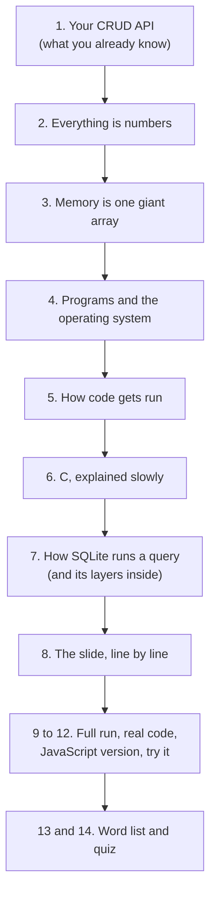

<a id="s0-6"></a>
### 0.6 Chapters at a glance

Almost every "chapter X.Y" or "section X.Y" in this file is a link. Click it to jump there. At the end of each chapter, a "Back to the chapter list" link brings you back here.

| Chapter | What it covers |
|---|---|
| [0. How to read this file](#s0) | where the slide comes from, the rules, the slide itself |
| [1. Start from what you know](#s1) | RAM, disk, databases, SQL, creating `music.db`, server vs library |
| [2. Everything is numbers](#s2) | bits, bytes, character codes, UTF-8, files as bytes |
| [3. Memory is one giant array](#s3) | addresses, C strings, pointers, virtual addresses |
| [4. Programs, processes and the OS](#s4) | CPU, OS, process, arguments, exit code, stdout/stderr |
| [5. How code becomes something the CPU can run](#s5) | machine code, compiler, executable |
| [6. C, explained slowly](#s6) | every piece of C on the slide, plus a cheat sheet ([6.22](#s6-22)) |
| [7. How SQLite runs a query](#s7) | prepare, bytecode, step, pages, transactions and locks, layers, indexes |
| [8. The slide, line by line](#s8) | every line of the slide, with JavaScript next to it |
| [9. The whole run, start to finish](#s9) | one full run as a flowchart, a conversation and a table |
| [10. Why the slide says "Pseudo-code"](#s10) | the real C code, and what the slide skips |
| [11. The same program in JavaScript](#s11) | `node:sqlite`, side by side with C, SQL injection, very large numbers, the chapter 1 API on SQLite, and how other SQLite libraries use the same functions |
| [12. Try it yourself](#s12) | commands to run everything on your computer, and what to read next |
| [13. Word list](#s13) | every term, plus words with more than one meaning |
| [14. Check yourself](#s14) | 25 quiz questions with hidden answers |
| [How this was checked](#checked) | how every fact and output was verified |

[Back to the chapter list](#s0-6)

---

<a id="s1"></a>
## 1. Start from what you know: your CRUD API

<a id="s1-1"></a>
### 1.1 A CRUD API that forgets everything

You have probably written something like this:

```js
// server.js
const express = require("express");
const app = express();
app.use(express.json());

const users = [];                      // all users are kept in this array

app.post("/users", (req, res) => {
  users.push(req.body);                // save a user
  res.status(201).json(req.body);
});

app.get("/users", (req, res) => {
  res.json(users);                     // send back all users
});

app.listen(3000);
```

It works. You add some users, you get them back. Then you stop the server with `Ctrl+C`, start it again, and **all users are gone**.

Why? The `users` array lived in the computer's **RAM**.

**RAM** (also called **memory**) is the computer's short-term working space. Everything your program is working on right now lives in RAM: every variable, every array, every object. RAM is very fast. But when a program stops, the RAM it used is taken back by the computer, so other programs can use it. Whatever the program kept there is gone. When the power goes off, everything in RAM is lost.

<a id="s1-2"></a>
### 1.2 Fixing it with a file

So you save users to a file instead:

```js
const fs = require("fs");

app.post("/users", (req, res) => {
  const users = JSON.parse(fs.readFileSync("users.json", "utf8"));  // read the whole file
  users.push(req.body);
  fs.writeFileSync("users.json", JSON.stringify(users));            // write the whole file
  res.status(201).json(req.body);
});
```

Now the users survive a restart, because the file is stored on the **disk**.

The **disk** (your SSD or hard drive) is the computer's long-term storage. Files live there. The disk keeps data even when the power is off. But it is much slower than RAM.

| | RAM (memory) | Disk |
|---|---|---|
| What lives there | the variables of running programs | files |
| Speed | very fast | much slower (hundreds to many thousands of times slower than RAM, depending on the disk) |
| When the program stops | gone | kept |
| When the power goes off | lost | kept |
| In your CRUD app | the `users` array | the `users.json` file |

<a id="s1-3"></a>
### 1.3 Why a JSON file is not enough

The JSON file works for 10 users. Now imagine your app grows. Three problems appear:

1. **Too slow.** You have 1 million users and you want just one of them. You still have to read the **whole** file and parse all of it, every single time.
2. **Broken files.** A **crash** is when a program stops suddenly, because of an error or because the power went off. Say the server crashes while `writeFileSync` is in the middle of writing. Now `users.json` is only half written, `JSON.parse` fails, and all your data is unreadable.
3. **Lost updates.** Your app grows, so you start two copies of the server to handle more traffic. Two requests arrive at the same moment, one at each copy. Both read the file, both add a user, both write the file back. The second write replaces the first one, and one user is lost. (With a single copy of the code above, this can't happen. `readFileSync` and `writeFileSync` don't let anything else run in between, and one Node process runs one request handler at a time. But it can happen with two processes, or inside one process if you switch to `fs.promises` and `await`, because every `await` lets another request run.)

A **database** is software built to solve exactly these problems. It keeps the data on disk, but:

1. It reads only the **small part** of the file it needs, not the whole thing.
2. It recovers from a half-finished write. If the power goes off while it is saving, the next program that reads the file puts it back the way it was before the save started. (Chapter [7.8](#s7-8) shows how.)
3. It never lets two writers change the file at the same time. (Chapter [7.8](#s7-8) shows how.)

**SQLite** is a database.

<a id="s1-4"></a>
### 1.4 Tables, rows, columns, and SQL

A database stores data in **tables**. A table is like a spreadsheet. Or, in JavaScript terms, like an array of objects where every object has the same keys.

Our example table is called `songs`:

| id | name | artist | year |
|---|---|---|---|
| 1 | Bohemian Rhapsody | Queen | 1975 |
| 2 | Hey Jude | The Beatles | 1968 |
| 3 | Untitled Demo | NULL | NULL |

- A **row** is one entry (one song). Like one object in the array.
- A **column** is one field (like `name`). Like one key of the objects.
- **NULL** in a database means "no value here". Like `null` in JavaScript. (This is the first of four meanings of "null". See chapter [6.11](#s6-11).)

The same data in JavaScript:

```js
const songs = [
  { id: 1, name: "Bohemian Rhapsody", artist: "Queen",       year: 1975 },
  { id: 2, name: "Hey Jude",          artist: "The Beatles", year: 1968 },
  { id: 3, name: "Untitled Demo",     artist: null,          year: null },
];
```

You talk to a database in a language called **SQL**. One SQL command is called a **SQL statement**. A SQL statement that asks for data is called a **query**:

```sql
SELECT name, artist FROM songs
```

This means "give me the `name` and `artist` of every row in `songs`". In JavaScript, it would be:

```js
songs.map(s => ({ name: s.name, artist: s.artist }))
```

The rows a query gives back are called the **result set**. For this query, the result set has 3 rows and 2 columns. (The slide's comment says "Number of columns in the result set". Now you know what that means.)

**Try it: make this table for real.** Later chapters read this exact table from a file called `music.db`, so let's create it now. You need SQLite's own command-line program, also called **`sqlite3`**. It runs SQL that you type in the terminal. Check that you have it:

```bash
sqlite3 --version
```

If it's missing, install it. On Ubuntu, or in WSL on Windows, run `sudo apt install sqlite3`. (`sudo` runs a command as the administrator, and `apt` is Ubuntu's installer. Chapter [12.4](#s12-4) has more.) A Mac already has it. Then run this once, in the folder where you'll keep the examples from this file:

```bash
sqlite3 music.db "CREATE TABLE songs(id INTEGER PRIMARY KEY, name TEXT, artist TEXT, year INTEGER);
INSERT INTO songs(name, artist, year) VALUES
  ('Bohemian Rhapsody', 'Queen', 1975),
  ('Hey Jude', 'The Beatles', 1968),
  ('Untitled Demo', NULL, NULL);"
```

It prints nothing. It creates the file `music.db` with the `songs` table inside. (If you run it a second time, you get an error saying the table already exists. That's fine. The file is already made.)

What the SQL means:

- `CREATE TABLE songs(...)` creates a table called `songs` with 4 columns.
- `INTEGER PRIMARY KEY` makes `id` a unique number for each row, filled in automatically (1, 2, 3...).
- `TEXT` and `INTEGER` are the column types: text and whole numbers.
- `INSERT INTO songs(...) VALUES (...)` adds rows.
- In SQL, text is written in **single quotes**, like `'Queen'`. The whole SQL is inside **double quotes** so the terminal hands it to `sqlite3` as one piece.

**Careful if you know TypeScript: these types are not enforced.** By default, SQLite treats a column type as a preference, not a rule. Tested: inserting the text `'nineteen'` into the `INTEGER` column `year` worked without any error, and SQLite stored it as text. If you want SQLite to refuse wrong types, add the word **`STRICT`** after the closing bracket: `CREATE TABLE songs(...) STRICT;`. Then the same insert fails with `cannot store TEXT value in INTEGER column`. (SQLite's documentation calls the default behavior **type affinity**.)

<a id="s1-5"></a>
### 1.5 SQLite is different from the databases you may have used

If you used PostgreSQL or MySQL in a CRUD project, you connected to it with a URL, something like this:

```js
// Pool = a group of open connections to the database server, ready to reuse
const pool = new Pool({ connectionString: "postgres://localhost:5432/mydb" });
```

`localhost` means "this same computer". `5432` is a **port**: a numbered door on a computer that a server program listens at. You already used one: `app.listen(3000)` makes your Express server listen at port 3000.

That URL points to a **database server**: a separate program, running on its own, that your API sends SQL to. Your API and the database are two different programs talking to each other. It's like your React app calling your Express API with `fetch`. Even when both run on your own laptop, they are separate programs sending messages to each other.

SQLite has **no server and no URL**. SQLite is a **library**: a package of code that you put **inside** your own program, like an npm package you `import`. It reads and writes the database file directly.

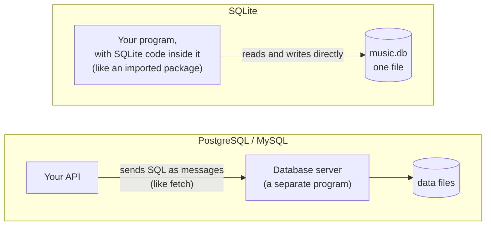

| | PostgreSQL | SQLite |
|---|---|---|
| Like... | calling another backend with `fetch` | calling a function you imported |
| How you reach it | a URL with a host and a port | a file name, like `music.db` |
| Where the data is | many files, managed by the server | one single file |

SQLite also keeps the whole database in **one file**. That's a separate design choice, not something that comes automatically with being a library. You can copy the file, email it, or put it on a USB stick. (While SQLite is in the middle of writing, it also uses a small temporary side file, explained in chapter [7.8](#s7-8). When nothing is writing, it's just the one file. Chapter [7.8](#s7-8) also covers a second mode, called WAL, which keeps two side files next to the database.) That's the "single file" idea from the start of the talk.

**You now know**

- **RAM** is fast, short-term memory. What a program keeps there is gone when the program stops.
- The **disk** is slow, long-term storage where files live.
- A **crash** is when a program stops suddenly.
- A **database** keeps data on disk safely, reads only what it needs, recovers from half-finished writes, and never lets two writers change the file at once.
- **Table**, **row**, **column**, **NULL**, **SQL**, **SQL statement**, **query**, **result set**.
- The **`sqlite3`** command-line program runs SQL from the terminal. You used it to create `music.db`. SQLite's column types are preferences (**type affinity**), unless the table is **`STRICT`**.
- A **port** is a numbered door a server listens at.
- **SQLite** is a **library** inside your program, not a separate **database server**. The whole database is one file.

[Back to the chapter list](#s0-6)

---

<a id="s2"></a>
## 2. Everything is numbers: bits and bytes

To understand C, you first need to know how a computer stores things. The short answer: **everything is stored as numbers**.

<a id="s2-1"></a>
### 2.1 Bits and bytes

A computer is made of billions of tiny electronic switches. Each switch is either off or on. We write off as `0` and on as `1`. One such switch is called a **bit**.

One bit can only say 0 or 1. That's not much. So bits are used in groups of eight. A group of 8 bits is called a **byte**.

How many different values can a byte hold? One switch has 2 positions. Each extra switch doubles the number of possibilities: 2 x 2 x 2 x 2 x 2 x 2 x 2 x 2 = **256**. So a byte can hold any whole number from **0 to 255**.

The byte is the basic unit of a computer. Every file, every part of RAM, every image, is just a long list of bytes.

Sizes are counted in bytes:

| Unit | Short for | About how many bytes |
|---|---|---|
| **KB** | kilobyte | 1 thousand |
| **MB** | megabyte | 1 million |
| **GB** | gigabyte | 1 billion |

So "this file is 12 KB" means it is about 12 thousand bytes long. "This laptop has 8 GB of RAM" means about 8 billion bytes of RAM.

<a id="s2-2"></a>
### 2.2 Text is numbers too

If everything is a number, how does a computer store the text `Queen`? Every letter has a fixed number, from a standard table called **ASCII**. ASCII covers English letters, digits and common symbols. Today there is also a much bigger table called **Unicode**, which has letters from every language, like Hindi and Tamil. For English letters, both tables use the same numbers. `Q` is 81, `u` is 117, `e` is 101, `n` is 110. Each of these numbers fits in one byte.

One letter, digit, space or symbol is called a **character**. Text is a list of characters, and each character is stored as its number, called its **character code**.

**Try it.** Open your browser's developer tools (press F12) and click the "Console" tab. Or type `node` in the terminal to open Node's console. Then paste the code and press Enter. (To leave Node's console, press `Ctrl+D`.)

```js
console.log("Queen".split("").map(c => c.charCodeAt(0)));  // the code of each letter
console.log(String.fromCharCode(72, 105));                  // letters from codes
```

Output:

```text
[ 81, 117, 101, 101, 110 ]
Hi
```

So the text `Queen` is really 5 bytes: `81 117 101 101 110`. And the two bytes `72 105` spell `Hi`.

**Other languages take more than one byte per character.** A byte holds only 256 different values, and Unicode has far more than 256 characters. So computers store Unicode text as **UTF-8**, the standard way to turn Unicode characters into bytes. In UTF-8, English letters still take 1 byte each, with the same codes as ASCII. Other characters take 2, 3 or 4 bytes. Test it in Node (`Buffer.from(text)` gives the UTF-8 bytes of some text, and section [2.3](#s2-3) explains `Buffer`):

```js
console.log(Buffer.from("Q").length, Buffer.from("த").length);   // bytes in UTF-8
```

Output:

```text
1 3
```

The Tamil letter `த` takes 3 bytes. Two things to remember:

- In C (chapter [6.4](#s6-4)), a `char` is one byte. That's one English letter, but only a part of `த`.
- JavaScript's `.length` and `charCodeAt` don't count bytes either. They count in their own units, called UTF-16. `"த".length` is 1, even though it's 3 bytes in UTF-8.

All the text in this file's examples is English, so from here on, one character is one byte.

<a id="s2-3"></a>
### 2.3 A file is a list of bytes

The SQLite database file `music.db` is a list of bytes too. Let's look at its first 16 bytes.

To run this, you need the file `music.db` that you created in chapter [1.4](#s1-4).

**Try it** with Node. Save this as `header.js` and run `node header.js`:

```js
const fs = require("fs");
const bytes = fs.readFileSync("music.db");   // read the whole file as raw bytes
console.log(bytes.length);                   // how many bytes the file has
console.log([...bytes.subarray(0, 16)]);     // the first 16 bytes, as normal numbers
console.log(JSON.stringify(bytes.subarray(0, 16).toString()));   // the same bytes as text
```

What each new piece does:

- `fs.readFileSync("music.db")` reads the file **without** turning it into text. Node gives you a **Buffer**: Node's array of raw bytes.
- `.subarray(0, 16)` takes bytes number 0 to 15.
- `[...x]` is JavaScript's **spread syntax**. It copies the items into a normal array, so Node prints them as plain numbers.
- `.toString()` turns the bytes into text.
- `JSON.stringify(...)` is used here because it shows invisible characters as codes, so you can see them.

Output:

```text
8192
[
   83,  81,  76, 105, 116, 101,
   32, 102, 111, 114, 109,  97,
  116,  32,  51,   0
]
"SQLite format 3\u0000"
```

The file is 8,192 bytes long. (Chapter [7.7](#s7-7) explains this number, and why yours might be 12,288.) The first 15 bytes are the character codes for the text `SQLite format 3` (83 is `S`, 81 is `Q`, 76 is `L`, and so on. 32 is a space). The 16th byte is `0`.

The byte 0 is not a letter, so it has nothing to show on screen. JSON writes it as `\u0000`, which is JSON's way of saying "the byte with the value 0".

Every SQLite database file in the world starts with these exact 16 bytes. (The only exception is a brand-new, empty file of 0 bytes, which SQLite treats as an empty database.) The first time SQLite reads page 1 of a file (during prepare, chapter [8.4](#s8-4)), it checks these bytes to make sure "this really is a SQLite file". If they are wrong, you get the error `file is not a database`.

Remember that `0` at the end. It comes back in the next chapter.

**You now know**

- A **bit** is one on/off switch (0 or 1).
- A **byte** is 8 bits, which can hold a number from 0 to 255.
- **KB**, **MB** and **GB** count bytes in thousands, millions and billions.
- Text is stored as numbers, one **character code** per **character**, from a table called **ASCII**.
- **Unicode** is the big table of characters for every language. **UTF-8** stores Unicode text as bytes. English letters take 1 byte. Other characters take 2 to 4.
- Node's **Buffer** is an array of raw bytes. **Spread syntax** `[...x]` copies items into a normal array.
- A file is a long list of bytes. Every SQLite file starts with `SQLite format 3` followed by a 0 byte.

[Back to the chapter list](#s0-6)

---

<a id="s3"></a>
## 3. Memory is one giant array

This chapter explains **pointers**, the idea that confuses most people about C. We will build it with plain JavaScript, step by step.

<a id="s3-1"></a>
### 3.1 RAM is a giant array of bytes

Picture all of RAM as **one huge array**, where each slot holds one byte. A computer with 8 GB of RAM has about 8 billion slots.

JavaScript has a kind of array that works exactly like this, called `Uint8Array`. Its name means:

- `U` = **unsigned**: no negative numbers allowed,
- `int` = whole numbers,
- `8` = each slot is 8 bits (one byte).

So a `Uint8Array` is an array where every slot holds one byte, a number from 0 to 255. This is a tiny pretend RAM with 32 slots:

```js
const memory = new Uint8Array(32);   // 32 slots, all start at 0
```

The **index** of a slot (0, 1, 2, ...) has a special name in computing. It's called an **address**. "The byte at address 10" just means `memory[10]`.

```text
address:   0    1    2   ...   10   11   12   13   14   15   ...
         +----+----+----+---+----+----+----+----+----+----+----
memory:  |  0 |  0 |  0 |...|  0 |  0 |  0 |  0 |  0 |  0 | ...
         +----+----+----+---+----+----+----+----+----+----+----
```

Every variable of every running program lives at some address in RAM.

<a id="s3-2"></a>
### 3.2 Putting text into memory

Let's store `Queen` in our pretend RAM, starting at address 10:

```js
const text = "Queen";
for (let i = 0; i < text.length; i++) {
  memory[10 + i] = text.charCodeAt(i);   // put each letter's code in the next slot
}
memory[10 + text.length] = 0;            // a 0 to mark "the text ends here"

console.log(memory);
```

Output:

```text
Uint8Array(32) [
  0,  0,   0,   0,   0,   0, 0, 0, 0,
  0, 81, 117, 101, 101, 110, 0, 0, 0,
  0,  0,   0,   0,   0,   0, 0, 0, 0,
  0,  0,   0,   0,   0
]
```

(Here Node printed 9 slots per line. The first line is addresses 0 to 8, so the second line starts at address 9. The `81` is at address 10.)

So `81 117 101 101 110` (`Queen`) sits at addresses 10 to 14, and a `0` sits at address 15.

**Why the 0 at the end?** Memory is just one long row of bytes. Nothing in it says where a piece of text stops. In JavaScript, strings have `.length`. In C, they don't. So C uses a simple rule:

> **Text continues until you reach a byte with the value 0.**

That 0 byte is called the **null terminator** ("the zero that ends it"). Here, "null" just means "zero". (This is another meaning of "null", number 3 in the list in chapter [6.11](#s6-11).)

In C code, the null terminator is written `\0`. The backslash `\` starts a special code inside text, called an **escape**. You already know one from JavaScript: `"\n"` means "new line". In the same way, `\0` means "the byte 0".

So this is what a string is in C: **characters in a row in memory, followed by a 0 byte.** The `SQLite format 3` text at the start of the database file ended with a 0 for the same reason.

<a id="s3-3"></a>
### 3.3 A pointer is a variable that holds an address

How do we refer to that text? We don't copy it. We just remember **where it starts**:

```js
let name = 10;    // "the text I care about starts at address 10"
```

That variable `name` is a **pointer**. A pointer is a variable whose value is an **address**. It doesn't hold the text. It holds **where the text is**.

To read the text, go to the address and keep reading until the 0:

```js
function readString(memory, address) {
  let result = "";
  while (memory[address] !== 0) {          // stop when we reach the 0 byte
    result += String.fromCharCode(memory[address]);
    address++;                             // move to the next slot
  }
  return result;
}

console.log(readString(memory, name));
```

Output:

```text
Queen
```

**This is exactly what C does every time it prints a string.** It gets an address, then walks forward one byte at a time until it finds a 0. You just wrote that yourself.

A real-life comparison: a house is big, and you can't carry it around. But you can write its street address on a small piece of paper and give it to anyone. A pointer is that piece of paper.

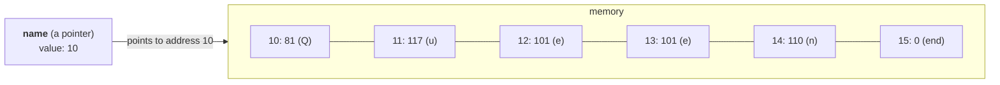

<a id="s3-4"></a>
### 3.4 Why use pointers at all?

1. **Big things are slow to copy.** Imagine an object that takes thousands of bytes. Giving a function its address (one number) is much faster than copying thousands of bytes every time you **pass** it. ("Pass" means "give a value to a function when you call it".)
2. **Sharing.** If two parts of a program have the same address, they both see the same thing. A change made through one is seen by the other.

<a id="s3-5"></a>
### 3.5 You already use pointers in JavaScript

```js
const a = { name: "Queen" };
const b = a;            // b does NOT get a copy
b.name = "Beatles";
console.log(a.name);    // "Beatles"
```

Why did changing `b` also change `a`? Because `a` doesn't hold the object. It holds the object's **address** in memory. `const b = a` copies the address, not the object. Now `a` and `b` point to the same object.

JavaScript calls this a **reference**, and hides the address from you. C shows the address openly and calls it a pointer. Same basic idea, with three differences you'll notice later:

1. **In C, an address is a number you can change.** You can add 1 to a pointer to move to the next item in memory. JavaScript never lets you do math on a reference.
2. **In C, you can take the address of anything**, even a plain number. In JavaScript, numbers and strings are always copied, never shared by reference. (Chapter [6.9](#s6-9) shows the C operator for this, `&`.)
3. **In C, an address stays fixed.** In JavaScript, the engine is allowed to move objects around in memory to tidy up, and it quietly updates every reference. You never see this, because you never see the address.

<a id="s3-6"></a>
### 3.6 Real addresses are bigger

Our pretend RAM has 32 slots, so an address like `10` fits in one byte. Real RAM has billions of slots, so real addresses are huge numbers.

Your computer is a **64-bit computer**. That means its addresses are 64 bits long. 64 bits / 8 bits per byte = **8 bytes**. So on your computer, **one address takes 8 bytes**. (Measured: a C pointer is 8 bytes on the 64-bit Linux laptop used to write this file.)

You will see real addresses printed in chapter [6.9](#s6-9). They look like `0x7fff12ce7fcc`. (That's only 12 digits, not 16, because leading zeros are not printed.) That's just a very big number written in **hexadecimal**, a way of writing numbers with 16 digits: 0 to 9 and then a to f (a is 10, f is 15). The `0x` at the start says "this is hexadecimal". Small examples: `0x10` is 16, and `0xff` is 255. You don't need to read long addresses. Just know that it is an address, which is a big number.

**Wait, isn't that number too big?** `0x7fff12ce7fcc` is about 140 trillion. A laptop with 8 GB of RAM has only about 8 billion slots. The reason: the addresses a program sees are not real positions in RAM. Each running program (a **process**, chapter [4.3](#s4-3)) gets its own private, pretend set of addresses, called **virtual addresses**, and the operating system (the **OS**, the main program that runs your computer, chapter [4.2](#s4-2)) quietly maps the ones the process uses onto real RAM. So the giant-array picture from [3.1](#s3-1) is still right. It's just that every process has its own array, and most of its slots aren't backed by real RAM. (One more detail you can ignore: the compiler sometimes keeps a small variable inside the CPU itself, in a tiny storage slot called a register, instead of in RAM.)

**You now know**

- RAM is like one giant array of bytes. The index of a slot is called an **address**.
- `Uint8Array` is a JavaScript array of bytes. **Unsigned** means "no negative numbers".
- A C string is characters in memory followed by a 0 byte, the **null terminator**, written `\0`. A backslash starts an **escape**, like `\n` or `\0`.
- A **pointer** is a variable that holds an address. It says **where** something is, not **what** it is.
- To **pass** a value means to give it to a function when calling it.
- JavaScript **references** are pointers that are hidden from you.
- On a **64-bit computer**, an address takes 8 bytes. Addresses are often printed in **hexadecimal**, like `0x7fff12ce7fcc`.
- Programs see **virtual addresses**: each process has its own pretend address range, which the OS maps onto real RAM.

[Back to the chapter list](#s0-6)

---

<a id="s4"></a>
## 4. Programs, processes and the operating system

<a id="s4-1"></a>
### 4.1 The CPU

The **CPU** (processor) is the chip that does the actual work. It can only do very simple things, like "add these two numbers", "copy this byte from here to there", or "if this number is 0, jump to step 7". Each simple step like that is called an **instruction**. A CPU runs billions of instructions every second.

<a id="s4-2"></a>
### 4.2 The operating system

The **operating system** (or **OS**) is the main program that runs your computer: Linux, Windows, macOS, Android. Its jobs include:

- starting and stopping other programs,
- sharing the RAM between them,
- controlling who can read and write which file,
- showing text in your terminal.

<a id="s4-3"></a>
### 4.3 Program vs process

A **program** is a file on disk that contains instructions. For example, `node` is a program. It's a file on your disk (you'll see its location in chapter [4.4](#s4-4)). While it just sits there, nothing happens.

A **process** is a program that is **running**. When you type `node server.js`, the OS loads the `node` program into RAM and starts it. That running copy is a process. The OS gives it its own private piece of RAM.

When you press `Ctrl+C`, the process ends, and the OS takes its RAM back. **That's why your `users` array disappeared in chapter [1](#s1).** The array lived in the process's RAM, and that RAM was taken back when the process ended.

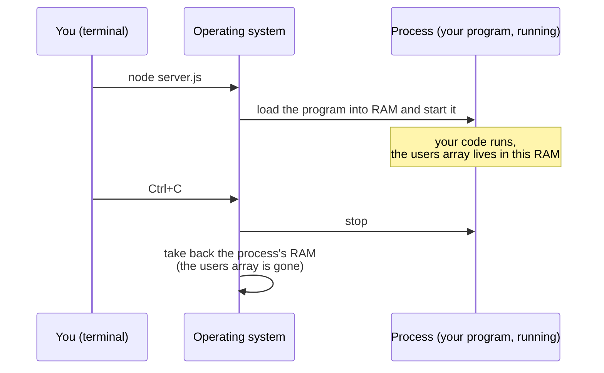

<a id="s4-4"></a>
### 4.4 Command-line arguments

The **command line** is the terminal, where you type commands. When you start a program there, you can type extra words after its name. These words are called **command-line arguments**.

```bash
node args.js music.db "SELECT name FROM songs"
```

Here, `music.db` and `SELECT name FROM songs` are the arguments. The quotes keep the whole SQL together as **one** argument. Without the quotes, each word would be a separate argument.

The OS gives these words to the process. In Node you get them in `process.argv`.

**Try it.** Save this as `args.js`:

```js
console.log(process.argv);
```

Run `node args.js music.db "SELECT name FROM songs"`. Output:

```text
[
  '/home/dev/.nvm/versions/node/v24.21.0/bin/node',
  '/.../args.js',
  'music.db',
  'SELECT name FROM songs'
]
```

An array of strings. The first item is where the `node` program file is on disk. (Your path will look different. `nvm` in this path is a tool that installs Node.) The second item is your script. Then come your arguments. Remember this. It's exactly what `argv` is on the slide.

<a id="s4-5"></a>
### 4.5 Exit code

When a process ends, it gives the OS one number that says how it went. This number is the **exit code**.

- `0` means "everything went fine".
- Any other number means "something went wrong".

In Node you set it with `process.exit()`. **Try it:**

```bash
node -e "process.exit(0)"; echo "exit code: $?"
node -e "process.exit(1)"; echo "exit code: $?"
```

What the pieces mean:

- `node -e "..."` runs the JavaScript written inside the quotes, without needing a file.
- `;` in the terminal means "after this command, run the next one".
- `echo` prints text.
- `$?` is replaced by the exit code of the last command.

Output:

```text
exit code: 0
exit code: 1
```

Tools like `npm`, `git` and GitHub Actions (a service that runs your tests on GitHub's computers) read this number to decide if a step passed or failed. When `npm test` shows a red failure, the test process ended with an exit code that is not 0.

<a id="s4-6"></a>
### 4.6 Two ways to print: stdout and stderr

Every process has two separate outputs:

- **stdout** ("standard output") is for normal output. In Node, `console.log` writes here.
- **stderr** ("standard error") is for error messages. In Node, `console.error` writes here.

Both appear in your terminal. But they are separate, so they can be sent to different places. For example, `node app.js > out.txt` sends stdout into the file `out.txt`, while stderr still shows on your screen. That way you still see errors.

**You now know**

- The **CPU** runs simple **instructions**, billions per second.
- The **operating system (OS)** starts programs, shares RAM and controls files.
- A **program** is a file. A **process** is a running program with its own RAM.
- The **command line** is the terminal. **Command-line arguments** are the words typed after a program's name. Node gives them as `process.argv`.
- The **exit code** is the number a process returns when it ends. 0 means success.
- **stdout** is for normal output. **stderr** is for errors.

[Back to the chapter list](#s0-6)

---

<a id="s5"></a>
## 5. How code becomes something the CPU can run

<a id="s5-1"></a>
### 5.1 The CPU doesn't understand JavaScript

The CPU only understands its own instructions, written as numbers. A list of these number-instructions is called **machine code**. The CPU doesn't understand JavaScript, Python or C. Something has to translate.

<a id="s5-2"></a>
### 5.2 Two ways to translate

**JavaScript: translated while running.** When you run `node app.js`, Node reads your JavaScript and translates it while the program runs. The `node` program is the translator. It must be there every time you run your code.

**C: translated once, before running.** A C programmer writes code in a file ending in `.c`. Then a program called a **compiler** translates the whole file into machine code **once**, and saves the result as a new file. Translating code this way is called **compiling**.

The new file is called an **executable**: a file of machine code that the computer can run directly. No translator is needed anymore.

The C compiler on Linux is called **`gcc`**. Here's how you use it:

```bash
gcc main.c -o main     # compile main.c. "-o main" means: name the output file "main"
./main                 # run the executable called "main" from this folder
```

`./` means "in this folder". So `./main` means "run the file `main` that is in this folder".

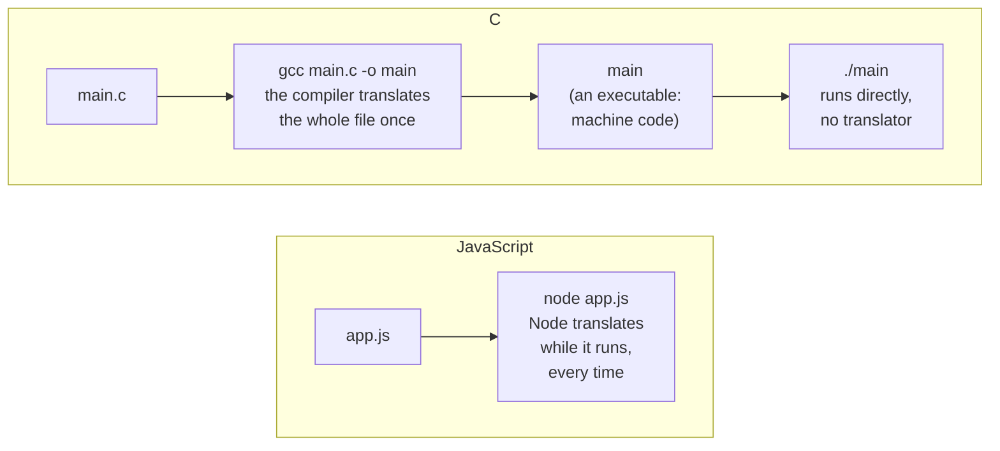

A comparison: JavaScript is like having a translator stand next to you at every meeting and translate as people speak. C is like translating a whole book once. After that, anyone can read the translated book, and the translator can go home.

<a id="s5-3"></a>
### 5.3 The compiler checks your code first

Before translating, the compiler checks your code. If something is wrong, for example a function called with the wrong number of inputs, it stops with an error and **does not create the executable**. Nothing runs.

You know this from **TypeScript**. When `tsc` says `Expected 2 arguments, but got 1`, that's the same kind of check.

Compiler errors look like this:

```text
slide.c:9:8: error: too few arguments to function 'sqlite3_open'
```

Read it as: file `slide.c`, line `9`, character `8`: there's an error. (You'll see this exact error in chapter [10](#s10).)

There are two kinds of errors:

- **Compile-time errors**: found by the compiler before the program runs. Like `tsc` errors.
- **Run-time errors**: happen while the program is running. Like a crash.

<a id="s5-4"></a>
### 5.4 What is C?

**C** is a programming language from 1972. It's older than almost everything you use. It's fast, because it is compiled straight into machine code. And it lets you work with memory directly, using addresses and pointers. Operating systems and SQLite are written in C. Node and browsers are written in C and its larger relative, C++.

JavaScript copied a lot of how C looks. That's why `{ }`, `;`, `if`, `while`, `for` and `i++` look the same in both languages.

**You now know**

- **Machine code** is the CPU's own language: instructions as numbers.
- A **compiler** translates a whole program into machine code once. That's called **compiling**. The result is an **executable**.
- `gcc file.c -o name` compiles. `./name` runs the executable from the current folder.
- The compiler checks your code first, like `tsc`. **Compile-time errors** stop the build. **Run-time errors** happen while running.
- **C** is an old, fast language that works with memory addresses directly.

[Back to the chapter list](#s0-6)

---

<a id="s6"></a>
## 6. C, explained slowly

This is the biggest chapter. It explains every piece of C on the slide, plus the few extra pieces the real version needs (chapter [10](#s10)). Each part shows the JavaScript or TypeScript you already know next to the C.

Take your time. If you get tired, stop at the end of a section and continue later.

<a id="s6-1"></a>
### 6.1 How to read a C line out loud

Before the details, here's one trick that makes C much easier.

Many C lines **create a variable**. To read such a line in English:

1. Find the variable's name first.
2. Then read the words and symbols to its left, one by one, from the nearest to the farthest.

Example:

```c
int nCol;
```

The name is `nCol`. To its left is `int`. So: "nCol is an int" (a whole number).

That's all for now. Lines with `*` use the same trick, but `*` needs its own sections first (6.8 to 6.10). At the end of section [6.14](#s6-14), you'll use this trick to read every kind of variable line on the slide.

This trick is a simplification. It works for every line on the slide. When something comes **after** the name, like the `[]` in `char connection[]` (section [6.10](#s6-10)), read that part first: "connection is an array of chars".

<a id="s6-2"></a>
### 6.2 Statements and the semicolon `;`

A **C statement** is one complete instruction in C code, like `nCol = 5;`. It's one "sentence" of the program.

> Careful: "statement" has three meanings in this file. A **SQL statement** is one SQL command (chapter [1.4](#s1-4)). A **C statement** is one instruction of C code (here). A **prepared statement** is a SQLite object (chapter [7.2](#s7-2)). Chapter [13.2](#s13-2) lists all of them.

In JavaScript, the `;` at the end of a statement is usually optional. **In C, it is required.** Every statement must end with `;`. Forget one and the program won't compile.

Real example. This C code is missing a `;` after `int x = 5`:

```c
int main(void){ int x = 5
 return 0; }
```

(Ignore `int main(void){` and `return 0; }` for now. They are the start and end of a tiny C program. Section [6.13](#s6-13) explains them.)

I saved this as a file called `c2.c` and compiled it. The compiler says:

```text
c2.c:2:2: error: expected ',' or ';' before 'return'
```

It means: in file `c2.c`, line 2, character 2, the compiler expected a `;` before the word `return`.

Which lines end with `;` and which don't?

| Line type | Ends with `;`? | Example |
|---|---|---|
| a normal statement | **yes** | `nCol = 5;` |
| creating a variable | **yes** | `int nCol;` |
| a line that opens a block | no | `while( ... ){` |
| a closing brace | no | `}` |
| a line starting with `#` (chapter [6.17](#s6-17)) | no | `#include <stdio.h>` |
| a function's name and inputs, without a body (chapter [6.12](#s6-12)) | **yes** | `int add(int a, int b);` |

<a id="s6-3"></a>
### 6.3 Comments

```c
  sqlite3 *db;            /* Database connection */
```

Everything between `/*` and `*/` is a **comment**: a note for humans. The compiler ignores it. JavaScript has the same `/* */` comments. (The `*` inside `/*` has nothing to do with pointers. Chapter [6.8](#s6-8) lists all the meanings of `*`.)

<a id="s6-4"></a>
### 6.4 Types: `int`, `char`, `unsigned`, `void`

In JavaScript, a variable can hold anything, at any time:

```js
let nCol;      // could later hold 5, or "hello", or an object
```

In TypeScript, you can say what a variable holds:

```ts
let nCol: number;
```

In C, you **must** say it. The kind of value a variable holds is called its **type**. In C, the type goes **before** the name:

```c
int nCol;
```

A variable's **type** can never change. Its **value** can change as often as you like.

**Why does C require types?** Because memory is just bytes (chapter [3](#s3)). Looking at the bytes `81 117 101 101`, you can't tell if they are text, a number, or an address. The compiler needs the type to know two things:

1. **how many bytes** the variable uses,
2. **what those bytes mean**.

The types you'll meet:

| C type | What it holds | Bytes on your computer | Like in JS/TS |
|---|---|---|---|
| `int` | a whole number, like `0`, `2`, `-7` | 4 | `number` (without decimals) |
| `char` | one byte, usually used for one English character (chapter [2.2](#s2-2)) | 1 | a one-letter string, or a small number (see the note below the table) |
| `unsigned char` | one byte, 0 to 255, never negative | 1 | one slot of a `Uint8Array` |
| `void` | "nothing" (chapter [6.12](#s6-12)) | | `void` in TypeScript |

(Sizes measured on the 64-bit Linux laptop used to write this file. Yours is almost surely the same.)

**Can a plain `char` be negative?** It depends on the computer. The C rules let each platform choose. On normal Intel or AMD computers (like the laptop used here) and on Apple Silicon Macs, a plain `char` goes from -128 to 127. On ARM Linux computers, like a Raspberry Pi or an Android phone, it goes from 0 to 255. For letters like `Q` (81) it makes no difference, because 81 fits in both. When you need "a byte from 0 to 255" everywhere, write `unsigned char`.

**A `char` is really just a number.** In C, `'Q'` with **single quotes** is one character. The compiler turns it into its code, 81, and you can store it in a `char`. Real test (`printf` prints text, like `console.log`. Section [6.16](#s6-16) explains it fully.):

```c
char c = 'Q';
printf("%c %d\n", c, c);    /* print c as a character, then as a number */
```

Output:

```text
Q 81
```

Same byte, shown two ways. (The `%c` and `%d` are explained in chapter [6.16](#s6-16).)

**`unsigned`** means "no negative numbers". Same meaning as the `U` in `Uint8Array`. You'll meet `unsigned char` in chapter [8](#s8).

<a id="s6-5"></a>
### 6.5 Variables: declaring and assigning

Creating a variable is called a **declaration**. Giving it a value is called an **assignment**:

```c
int nCol;        /* declaration: create nCol */
nCol = 2;        /* assignment: store 2 in it */
int age = 25;    /* both at once */
```

```js
let nCol;        // declaration
nCol = 2;        // assignment
let age = 25;    // both at once
```

**Important difference.** In JavaScript, `let x;` gives `x` the value `undefined`. In C, a new variable inside a function **is not cleared**. It contains whatever bytes were left in that piece of memory from before. These leftover bytes are often called **garbage**.

Real test. A function `f` puts `12345` in a variable and ends. Then a function `g` creates a variable `y` and prints it **without assigning anything**. (`void f(void)` creates a function `f` that takes no inputs and gives back nothing. Section [6.12](#s6-12) explains this.)

```c
#include <stdio.h>

void f(void){ int x = 12345; }
void g(void){ int y; printf("y = %d\n", y); }

int main(void){
  f();
  g();
  return 0;
}
```

Running it printed:

```text
y = 12345
```

`y` was never given a value, but it printed `12345`, the leftover from `f`. So in C, **always assign a value before you read a variable**. On the slide, `db`, `pStmt` and `nCol` hold garbage until lines 6, 7 and 8 assign them.

(Why did it print exactly `12345`? Both functions used the same piece of memory, one after the other. `f`'s leftover value was still there when `g` started. But this is not reliable. When I compiled the same file with `gcc -O2` (a setting that makes gcc speed up the program), it printed `y = 0`. The compiler even warns about it if you ask it to, with `gcc -Wall` ("'y' is used uninitialized").)

**Why did `-O2` change the answer?** Reading a variable that was never given a value is not just "reading leftover bytes". The C rules call it **undefined behavior**: C makes no promise at all about what happens. (Chapter [10.4](#s10-4) shows another example of undefined behavior, where it crashes the program.) When it speeds up a program, the compiler is allowed to assume your code never does this. So it may change or remove that read completely. That's why `-O2` printed something different. The leftover-bytes picture helps you imagine where garbage comes from, but the real rule is simpler: **never read a variable before you assign it**, because then anything can happen.

<a id="s6-6"></a>
### 6.6 `const`: careful, it means something different from JavaScript

In JavaScript:

```js
const x = 5;
x = 6;          // error: you can't reassign x
```

In C, `const` on a normal variable means the same thing. Real test, saved as `c1b.c`:

```c
#include <stdio.h>
int main(void){
  const int x = 5;
  x = 6;
  return 0;
}
```

```text
c1b.c:4:5: error: assignment of read-only variable 'x'
```

Line 4 is `x = 6;`. The compiler refuses to build it.

**But with pointers, C's `const` means something different.** You'll see this in the real code:

```c
const char *zVal;
```

This does **not** mean "zVal can't change". It means "**the characters that zVal points to** must not be changed through zVal". You can still put a different address in `zVal`.

| | What is protected? |
|---|---|
| JS `const zVal = ...` | the variable `zVal`. You can't reassign it. |
| C `const char *zVal` | the **text** `zVal` points to. You can't edit the text through `zVal`. You **can** reassign `zVal`. |

Think of it as "a pointer to **read-only** text". SQLite uses it to say "here's some text, you may read it, but don't change it".

<a id="s6-7"></a>
### 6.7 Text: single quotes, double quotes, and escapes

In JavaScript, `'hi'` and `"hi"` are the same thing. **In C, they are different:**

| C | Meaning | Type |
|---|---|---|
| `'Q'` (single quotes) | **one** character. Really the number 81. | a number (C counts it as an `int`), usually stored in a `char` |
| `"Queen"` (double quotes) | text: the characters plus a hidden `\0` at the end | an array of `char`. When you use it, C gives you its address, a `char *`. |

(And in SQL, text uses single quotes: `'Queen'`. Three languages, three habits.)

Text written directly in code, like `"Row:\n"`, is called a **string literal**. The compiler stores its characters somewhere in memory, adds a `\0` at the end, and uses its address.

Proof that the hidden `\0` is really there. **`sizeof`** is a C **operator** (a built-in symbol or word that does something to a value, like `+` or `==`). `sizeof` tells you how many bytes something takes. Real test:

```c
printf("%zu\n", sizeof("Queen"));    /* %zu prints a size, like the result of sizeof */
```

```text
6
```

**6, not 5.** Five letters, plus the null terminator. (Here `sizeof` measures the text itself. If you measured a `char *` variable instead, you'd get 8, the size of an address.)

**Escapes** are special codes that start with a backslash `\`. They work the same as in JavaScript strings:

| Escape | Meaning |
|---|---|
| `\n` | new line |
| `\0` | the byte 0 (the null terminator) |

<a id="s6-8"></a>
### 6.8 The many meanings of the star `*`

The `*` symbol is the most confusing thing in C, because it has several jobs. Here's every meaning you'll meet:

| Where you see `*` | Example | Meaning |
|---|---|---|
| **in a declaration, after a type** | `sqlite3 *db;` | "db is a **pointer**" (holds an address) |
| **in front of a pointer, in normal code** | `*p = 30;` | "**go to the address** in p" (chapter [6.9](#s6-9)) |
| between two numbers | `a * b` | multiply (same as JS) |
| in a comment marker | `/* ... */` | part of the comment marker. Nothing to do with pointers. |
| in SQL | `SELECT * FROM songs` | "all columns". Nothing to do with C. |

Line 2 of the slide, `sqlite3 *db;            /* Database connection */`, has three stars. The first means "pointer". The other two are part of the comment.

**Spaces around `*` don't matter.** These three lines are exactly the same to the compiler:

```c
char *name;
char* name;
char * name;
```

The slide's style is `char *name`. Some code uses `char* name`. Both mean "name is a pointer to char".

<a id="s6-9"></a>
### 6.9 `&` (address of) and `*` (go to the address)

The slide doesn't use these two **operators**. (An operator is a symbol that does something to values, like `+`, `==` or `&&`.) But the real version in chapter [10](#s10) uses `&`, and `*` shows what SQLite does with that address. Both make pointers much clearer.

- **`&x`** means "**the address of** `x`". Where does `x` live in memory?
- **`*p`** (in normal code, not in a declaration) means "**go to the address stored in `p`**", to read or write what's there.

Here's the main part of a tiny real C program (the `#include` line and `main` around it are left out):

```c
int age = 25;          /* a normal int variable */
int *p = &age;         /* p is a pointer. It gets the address of age. */

printf("age          = %d\n", age);
printf("&age         = %p\n", (void*)&age);    /* %p prints an address */
printf("p            = %p\n", (void*)p);
printf("*p           = %d\n", *p);

*p = 30;               /* go to the address in p, and write 30 there */
printf("age is now   = %d\n", age);
```

(Ignore `(void*)` for now. `%p` needs it to print an address. Section [6.18](#s6-18) explains it.)

Real output:

```text
age          = 25
&age         = 0x7fff12ce7fcc
p            = 0x7fff12ce7fcc
*p           = 25
age is now   = 30
```

Read it:

- `&age` is `0x7fff12ce7fcc`, a big address in hexadecimal (chapter [3.6](#s3-6)). That's where `age` lives.
- `p` holds the same address. So `p` "points to" `age`.
- `*p` is 25. "Go to that address and read" gives `age`'s value.
- `*p = 30` wrote 30 **at that address**. So `age` became 30, even though we never wrote `age = 30`.

Run it again, and the addresses are different (the OS picks a new place each run). Second run: `0x7ffdb9ce444c`. The idea stays the same.

**The same thing with our pretend memory in JavaScript:**

```js
const memory = new Uint8Array(64);

// The compiler decides where each variable lives. Let's say:
const ADDR_age = 5;   // age lives at address 5
const ADDR_p = 6;     // p lives at address 6

// int age = 25;
memory[ADDR_age] = 25;

// int *p = &age;       "&age" = the address where age lives = 5
memory[ADDR_p] = ADDR_age;

console.log("age  =", memory[ADDR_age]);          // the value of age
console.log("&age =", ADDR_age);                  // where age lives
console.log("p    =", memory[ADDR_p]);            // p holds an address
console.log("*p   =", memory[memory[ADDR_p]]);    // go to that address and read

// *p = 30;             go to the address stored in p, write 30 there
memory[memory[ADDR_p]] = 30;
console.log("age is now", memory[ADDR_age]);
```

Real output:

```text
age  = 25
&age = 5
p    = 5
*p   = 25
age is now 30
```

Same result. `*p` is just `memory[memory[ADDR_p]]`: read the address out of `p`, then use it as an index.

> **Don't mix up `&` and `&&`.** In C and JavaScript, `&&` means "and" (`a && b`). A **single** `&` written right before a variable name, like `&db`, means "address of". Different things. (A single `&` **between** two numbers, like `a & b`, is a third operator, "bitwise and", which works on the bits. It exists in JavaScript too. This file doesn't use it.)

<a id="s6-10"></a>
### 6.10 `**`: a pointer to a pointer, and its two jobs

`**` means "a pointer to a pointer": **the address of a place that holds an address**. It's used for two different jobs. Both appear in this file.

**Job 1: a list of strings (`char **argv` on the slide).**

Each string is a `char *` (an address of text). If you have several strings, you put their addresses one after another in memory. To refer to that list, you hold the address of its first item. That address is a `char **`.

Here's how the command `./query music.db "SELECT ..."` could look in memory. (The addresses are made up, and small, to keep it readable. Each real address takes 8 bytes, so the list items are 8 apart.)

```text
argv = 40              "the list starts at address 40"

address 40-47:  100    <- argv[0]: the first string starts at address 100
address 48-55:  120    <- argv[1]: the second string starts at address 120
address 56-63:  140    <- argv[2]: the third string starts at address 140

address 100...: . / q u e r y \0
address 120...: m u s i c . d b \0
address 140...: S E L E C T   ... \0
```

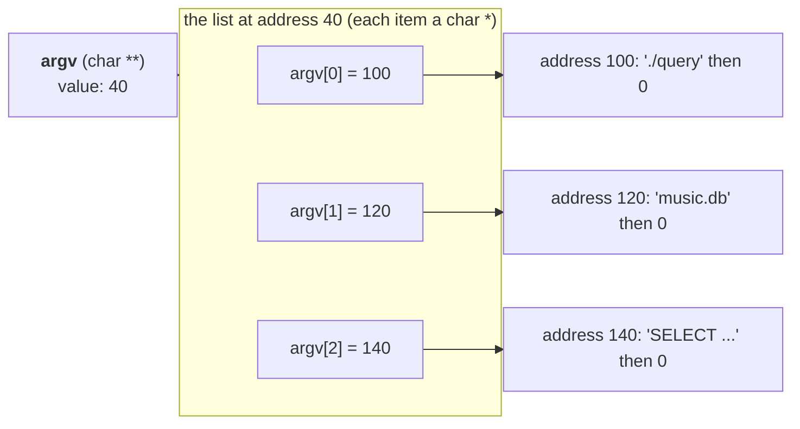

**Lists in C have no `.length`.** Nothing in memory stores the count "3 items". (There is an end marker, a NULL pointer (section [6.11](#s6-11)) after the last item, but you'd have to walk through the whole list to find it.) That's why `main` also gets a second value, **`argc`**, the number of items. In JavaScript, `process.argv` is a real array with a `.length`. In C, you get the list and its length separately.

**Job 2: "tell me where to put the answer".**

The real `sqlite3_open` looks like this (more in chapter [10](#s10)):

```c
int sqlite3_open(const char *filename, sqlite3 **ppDb);
```

Here, `sqlite3 **ppDb` is **not** a list. It is **the address of your own `db` variable**. `db` is a `sqlite3 *` (a pointer). So the address of `db` is a `sqlite3 **` (a pointer to a pointer).

Why would SQLite want the address of your variable? So it can **write the handle into it**. (A **handle** is explained in section [6.14](#s6-14). For now, think of it as the address of the connection SQLite creates.)

The inputs of a function are called its **parameters** (section [6.12](#s6-12) explains them fully). A parameter that is used to send a result back **out** of the function is called an **output parameter**. `ppDb` is one.

You have seen this shape in React. You create `const inputRef = useRef(null)` and write `<input ref={inputRef} />`. You don't get the input element back from anything. Instead, React writes it into `inputRef.current` for you. `&db` plays the part of `inputRef`, and SQLite writing the handle into `db` is React writing into `inputRef.current`.

Here's that pattern, simulated in JavaScript with our pretend memory:

```js
const memory = new Uint8Array(64);
const SQLITE_OK = 0;

// sqlite3 *db;   our variable db lives at address 10. It starts empty (0).
const ADDR_db = 10;
memory[ADDR_db] = 0;

// A pretend sqlite3_open(filename, ppDb).
// ppDb is NOT the connection. It's the ADDRESS OF OUR db VARIABLE.
function sqlite3_open(filename, ppDb) {
  const connectionAddress = 40;     // SQLite builds the connection at address 40
  memory[ppDb] = connectionAddress; // *ppDb = connection. Write into OUR variable.
                                    // (A real address takes 8 bytes. Our pretend one fits in 1.)
  return SQLITE_OK;                 // the return value is only the status code
}

console.log("before: db =", memory[ADDR_db]);
const rc = sqlite3_open("music.db", ADDR_db);  // in C: sqlite3_open("music.db", &db)
console.log("rc =", rc);
console.log("after:  db =", memory[ADDR_db]);
```

Real output:

```text
before: db = 0
rc = 0
after:  db = 40
```

Before the call, `db` was empty. We gave the function `db`'s **address**. The function wrote `40` there. After the call, `db` holds 40, the address of the connection.

And the same thing in real C, with a pretend open function. This is the complete file that was compiled and run:

```c
#include <stdio.h>

/* A pretend "open" that works like sqlite3_open:
** it returns a status code, and writes the handle
** into the caller's variable through its address. */
int fake_open(const char *filename, char **ppOut){
  static char connection[] = "a pretend connection";
  printf("fake_open got filename=%s and ppOut=%p\n", filename, (void*)ppOut);
  *ppOut = connection;   /* write into the caller's variable */
  return 0;              /* 0 means OK */
}

int main(void){
  char *db = NULL;       /* empty: points to nothing yet */
  int rc;
  printf("before: db=%p, &db=%p\n", (void*)db, (void*)&db);
  rc = fake_open("music.db", &db);
  printf("after:  rc=%d, db=%p, text at db=%s\n", rc, (void*)db, db);
  return 0;
}
```

New pieces in this code:

- The text between `/*` and `*/` at the top is a comment over several lines. The `**` at the start of each line is just decoration inside the comment.
- `char connection[]` creates an **array** of characters (C's version of a fixed list), filled with the text `"a pretend connection"`.
- `static` means "keep this memory alive after the function ends". Without `static`, `connection` would disappear when `fake_open` returns (section [6.20](#s6-20) explains why), and `db` would point at garbage.
- **This is a shortcut, not how SQLite does it.** A `static` variable exists only once for the whole program. That's fine for a pretend example. The real `sqlite3_open` must be able to create many separate connections, so it creates each one fresh in manual memory, the heap (section [6.20](#s6-20)), and `sqlite3_close` frees it again.
- `NULL` means "points to nothing" (section [6.11](#s6-11)).

Real output. The second line comes from the `printf` inside `fake_open`:

```text
before: db=(nil), &db=0x7ffc49e99dd0
fake_open got filename=music.db and ppOut=0x7ffc49e99dd0
after:  rc=0, db=0x5bd8194df010, text at db=a pretend connection
```

- Before: `db` was `(nil)`, meaning "points to nothing" (section [6.11](#s6-11)). (On a Mac, the same thing prints as `0x0`.)
- `&db` (where `db` lives) was `0x7ffc49e99dd0`. The function received exactly that address as `ppOut`.
- After: `db` holds a new address, and following it gives the connection's text.

So `**` always means the same thing, "address of an address". With `argv`, it's used as a list. With `ppDb`, it's used as "where to put the answer". The name helps: **`pp` = pointer to pointer**.

<a id="s6-11"></a>
### 6.11 The four meanings of "null"

The word "null" appears in four different ways in this file. All four have to do with **zero** or **nothing**.

| Name | Where | What it is | Written as |
|---|---|---|---|
| **SQL NULL** | in a database | "no value in this cell" | `NULL` in SQL |
| **JavaScript null** | in JS | "no value" | `null` |
| **null terminator** | at the end of C text | the **byte** with value 0 that ends a string | `\0` |
| **NULL pointer** | in C | an **address** with value 0, meaning "points to nothing" | `NULL` in C. On Linux, `%p` prints it as `(nil)`. On a Mac, it prints `0x0`. |

A **NULL pointer** is a pointer that points nowhere. Operating systems never put a program's data at address 0, so C uses 0 to mean "no address". It's like a pointer version of JavaScript's `null`.

SQLite connects two of these. When a cell in the database is **SQL NULL**, SQLite's `sqlite3_column_text` gives back a **NULL pointer**. ("There is no text, so here's an address of nothing.") Chapter [10.4](#s10-4) shows why that's dangerous on the slide.

In C, a NULL pointer counts as **false** in a condition, just like `null` is falsy in JavaScript. So `zVal ? zVal : "NULL"` means "if zVal points to something, use it, otherwise use the text NULL". (`a ? b : c` works the same as in JavaScript. Section [6.15](#s6-15) lists it.)

<a id="s6-12"></a>
### 6.12 Functions: definitions, declarations, parameters, `void`

**Writing a function.** A C function looks like a TypeScript function, but the types are in different places:

```ts
// TypeScript
function add(a: number, b: number): number {
  return a + b;
}
```

```c
/* C */
int add(int a, int b){
  return a + b;
}
```

- The **return type** (`int`, the type of the value given back) comes **first**, before the function name.
- Each **parameter** (input) has its type before its name.

The values you give when calling a function, like the `2` and `3` in `add(2, 3)`, are called **arguments**.

> Careful: "argument" has two meanings in this file. **Function arguments** are values given to a function when you call it. **Command-line arguments** are words typed after a program's name (chapter [4.4](#s4-4)). Same idea, "values given at the start", but in different places. The compiler error "too few arguments" is about function arguments.

**Definition vs declaration.** The code above, with a body `{ ... }`, is a **function definition**. It contains the actual code.

C also has **function declarations**: only the name, the parameters and the return type, **with no body**. They end with `;`:

```c
int add(int a, int b);     /* declaration: "a function called add exists, here's its shape" */
```

A declaration tells the compiler "this function exists somewhere, and this is how to call it". The compiler uses it to check your calls. It's like a TypeScript type for a function, with no code inside.

**Header files (chapter [6.17](#s6-17)) are full of declarations.** That's how the compiler knew `sqlite3_open` needs 2 arguments.

**`void`** means "nothing":

| C | Meaning | TypeScript |
|---|---|---|
| `void f(...)` | f returns nothing | `function f(...): void` |
| `int main(void)` | main takes no parameters | `function main()` |

(There's one more use, `void *`, where `void` means "any type" instead of "nothing". Section [6.18](#s6-18) explains it.)

**A C function returns one value.** JavaScript functions also return one value, but you often return an object to send back several things: `return { rc, db }`. C could do something similar, but C libraries have a habit instead: **return the status code, and write other results through addresses** (output parameters, chapter [6.10](#s6-10)). That's why `sqlite3_open` needs `&db`.

<a id="s6-13"></a>
### 6.13 `main`, `argc` and `argv`

In Node, your file runs from the top line to the bottom line.

A C program is made of functions. When the program starts, the function named **`main`** is called first. Every C program starts in `main`. When `main` returns, the program ends.

```c
int main(int argc, char **argv){
```

Read it piece by piece:

| Part | Meaning |
|---|---|
| `int` | `main` returns a whole number: the **exit code** (chapter [4.5](#s4-5)) |
| `main` | the function's name. It is called first. |
| `int argc` | first parameter: the **arg**ument **c**ount, how many words were typed |
| `char **argv` | second parameter: the **arg**ument **v**alues, the list of typed words (chapter [6.10](#s6-10), job 1) |
| `{` | the body of `main` starts here |

For the command `./query music.db "SELECT name, artist FROM songs"`:

| C | Value | Node version |
|---|---|---|
| `argc` | `3` | `process.argv.length - 1` |
| `argv[0]` | `"./query"` | `process.argv[1]` |
| `argv[1]` | `"music.db"` | `process.argv[2]` |
| `argv[2]` | `"SELECT name, artist FROM songs"` | `process.argv[3]` |

Node's list has one extra item at the start (where the `node` program is). A C program doesn't need Node, so it doesn't have that item. `argv[0]` is the program's own name.

<a id="s6-14"></a>
### 6.14 `struct`, `typedef`, and handles

JavaScript has objects. C has something similar called a **struct**: a group of named values stored together in memory. The named values inside are called **fields** (like the keys of a JS object). Unlike a JS object, a struct's fields are fixed. You can't add or remove fields while the program runs. A TypeScript `interface` describes the same kind of fixed object.

**Where does the type name `sqlite3` come from?** SQLite's header file (chapter [6.17](#s6-17)) contains this line:

```c
typedef struct sqlite3 sqlite3;
```

**`typedef`** means "make a short name for a type". Here's why it's needed. In C, the full name of a struct type is two words: `struct sqlite3`. Writing `struct` every time is long. This `typedef` line says: "from now on, the one word `sqlite3` means `struct sqlite3`". So you can write `sqlite3 *db;` instead of `struct sqlite3 *db;`. In the same way:

```c
typedef struct sqlite3_stmt sqlite3_stmt;
```

(`stmt` is short for "statement".)

**SQLite hides what's inside these structs.** The header file never lists their fields. You can't look inside or change them. You only get their **address**, and you give that address back to SQLite's functions when you want something done.

An address used this way is called a **handle**.

You already work like this in your CRUD API. When you `POST /users`, the server gives you back an `id`. You don't hold the user. You hold an id. Later you call `GET /users/42`, and the server looks it up. **A handle works like that id.** SQLite keeps the real object. You keep the handle and pass it in every call.

One difference: SQLite doesn't need to look anything up. The handle **is** the object's real address, so SQLite goes straight to it. C programmers call a pointer like this, to something whose insides you can't see, an **opaque pointer**.

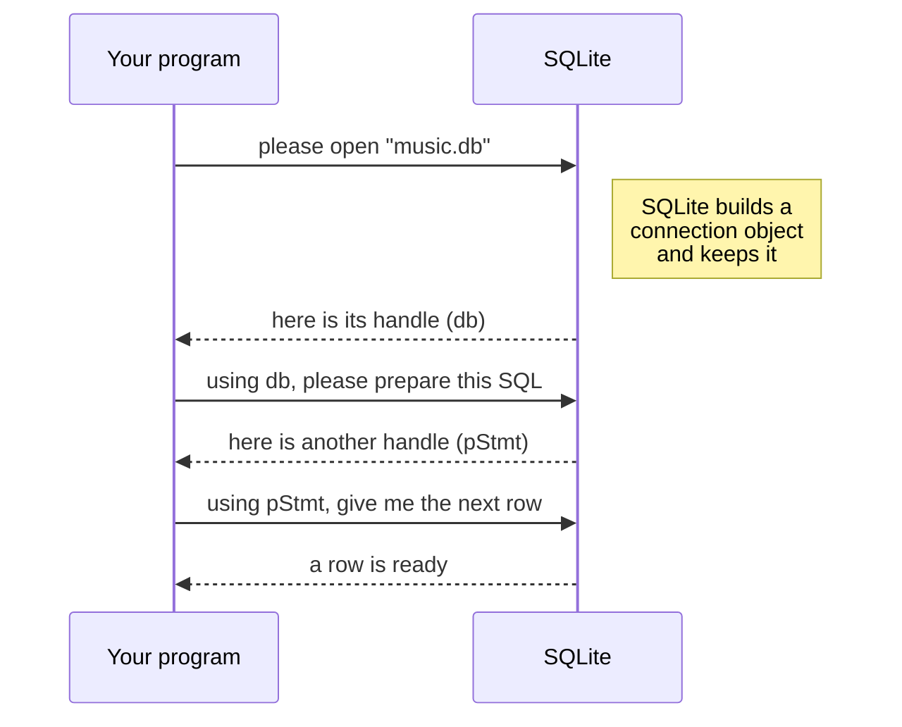

**The many `sqlite3`s.** The name `sqlite3` shows up in several roles. The `3` means **version 3** of SQLite, which has been the current version since 2004.

| Where | What it is |
|---|---|
| SQLite, the library | the database code |
| `sqlite3` in C code | the type name of the connection struct |
| `sqlite3_open`, `sqlite3_step`, ... | the prefix on every SQLite function name (chapter [6.17](#s6-17)) |
| `sqlite3.h` | SQLite's header file |
| `sqlite3` in the terminal | SQLite's own command-line program (chapter [1.4](#s1-4)) |
| Python's `sqlite3` | Python's library that uses SQLite |

**Name prefixes.** SQLite's code uses short letters at the start of names as hints:

| Prefix | Means | Example |
|---|---|---|
| `p` | pointer | `pStmt` |
| `pp` | pointer to pointer | `ppDb` |
| `n` | number of | `nCol` |
| `z` | text ending with a zero byte | `zVal`, `zSql` |
| `rc` | return code (the status code) | `rc` |

These are only naming habits. The compiler doesn't care about them.

**Now read the slide's variable lines out loud.** You know enough to use the trick from section [6.1](#s6-1) on every one of them. Find the name, then read to the left. A `*` is read as "a pointer to".

| C | Read from the name to the left | In plain English |
|---|---|---|
| `int nCol;` | `nCol` ... `int` | nCol is a whole number |
| `char *name;` | `name` ... `*` ... `char` | name is a pointer to a char (a string) |
| `sqlite3 *db;` | `db` ... `*` ... `sqlite3` | db is a pointer to a sqlite3 (a handle to a connection) |
| `sqlite3_stmt *pStmt;` | `pStmt` ... `*` ... `sqlite3_stmt` | pStmt is a pointer to a sqlite3_stmt (a handle to a statement) |
| `char **argv` | `argv` ... `*` ... `*` ... `char` | argv is a pointer to a pointer to char (a list of strings) |

<a id="s6-15"></a>
### 6.15 Operators that work like JavaScript

| C | Meaning | JavaScript |
|---|---|---|
| `=` | store a value | same |
| `==` | is equal to | `===` |
| `!=` | is not equal to | `!==` |
| `<` | less than | same |
| `i++` | add 1 to i | same |
| `a ? b : c` | if a, then b, else c | same |

C has no `===`. In JavaScript, `==` sometimes changes types by itself, so `"5" == 5` is `true`. C's `==` never turns text into a number like that. But it has two surprises of its own.

**Surprise 1: `==` on text compares addresses, not letters.** A `char *` holds an address (chapter [3.3](#s3-3)). So `==` between two `char *` asks "do these point to the same place?", not "do they hold the same letters?". To compare the letters, C has a function called **`strcmp`** ("string compare"), declared in the header `string.h` (chapter [6.17](#s6-17)). It walks both texts byte by byte and returns 0 when they are the same. Real test (the `#include` lines and `main` around it are left out):

```c
char a[] = "Queen";          /* one copy of the text (an array, section 6.10) */
char b[] = "Queen";          /* a second copy, somewhere else in memory */
const char *x = a;
const char *y = b;
printf("x == y       : %d\n", x == y);           /* compares the addresses */
printf("strcmp(x, y) : %d\n", strcmp(x, y));     /* compares the letters */
```

Output:

```text
x == y       : 0
strcmp(x, y) : 0
```

The two zeros mean opposite things. `x == y` gave 0, which is C's "false": two copies of `Queen` live at two different addresses. `strcmp` gave 0, which means "no difference": the letters are the same. So in C, test text with `strcmp(x, y) == 0`, never with `x == y`.

**Surprise 2: mixing number types.** In C, `-1 < 1u` is false (tested). (`1u` is an unsigned 1, and C quietly turns the -1 into a huge unsigned number before comparing.) The simple rule: compare values of the same type.

**Assignment inside a condition.** The real code (chapter [10](#s10)) has this:

```c
while( (rc = sqlite3_step(pStmt))==SQLITE_ROW ){
```

It does two things: first `rc = sqlite3_step(pStmt)` (call step and store the answer), then compares `rc` with `SQLITE_ROW`. The extra `( )` around the assignment make sure it happens first. **Linters** (tools like ESLint that warn about risky code) warn about an assignment inside a condition, because people often write `=` when they meant `==`. The extra `( )` tell both the linter and the reader that you meant it. ESLint's default rule accepts it with the brackets, and C programmers use the same habit.

**Loops** look the same as in JavaScript:

| C | JavaScript |
|---|---|
| `while( condition ){ ... }` | `while (condition) { ... }` |
| `for(i=0; i<nCol; i++){ ... }` | `for (let i = 0; i < nCol; i++) { ... }` |

C ignores line breaks and extra spaces, like JavaScript. The slide's `printf(` call is spread over 4 lines, but it's one call.

**`int i;` on its own line.** On the slide:

```c
  while( sqlite3_step(pStmt)==SQLITE_ROW ){
    int i;
    printf("Row:\n");
    for(i=0; i<nCol; i++){
```

In JavaScript you'd write `for (let i = 0; ...)`. Very old C didn't allow creating a variable inside `for ( )`. You had to create variables at the top of a `{ }` block first. So `int i;` sits at the top of the `while` block, and the `for` uses it. SQLite keeps this old style so that it still compiles with very old compilers.

<a id="s6-16"></a>
### 6.16 Printing: `printf`, `fprintf`, `stdout`, `stderr`

```c
printf("  %s = %s\n", name, value);
```

The same in JavaScript:

```js
console.log(`  ${name} = ${value}`);
```

`printf` writes to **stdout** (chapter [4.6](#s4-6)). The first input is a template, called the **format string**. Each `%` code in it is a hole, filled by the next value, in order. These codes are called **format specifiers**:

| Specifier | Fill with | Example output |
|---|---|---|
| `%s` | text (a `char *`) | `Queen` |
| `%d` | a whole number (`int`) | `25` |
| `%c` | one character | `Q` |
| `%p` | an address | `0x7fff12ce7fcc` |
| `%zu` | a size, like the result of `sizeof` | `6` |

`printf` does **not** add a new line by itself (unlike `console.log`). That's why the slide writes `\n`.

**How `%s` works.** `%s` expects an **address**. `printf` goes to that address and prints characters until it hits a 0 byte, exactly like our `readString` in chapter [3.3](#s3-3).

**`fprintf(stderr, ...)`** is `printf`, but you choose where to write. The `f` stands for "file", because C treats outputs like files. **`stderr`** is a ready-made handle for the error output, given to you by the C standard library. So `fprintf(stderr, ...)` is `console.error(...)`.

`printf`, `fprintf`, `stdout` and `stderr` come from the **C standard library**: a set of basic functions every C setup includes, like `console` and `Math` in JavaScript. They're declared in a header file called `stdio.h` ("**st**andar**d** **i**nput/**o**utput").

**A trap when debugging crashes: buffering.** `printf` doesn't always write its text out straight away. It often collects text in a waiting area in memory, called a **buffer**. (Not Node's `Buffer` from chapter [2.3](#s2-3). Same word, related idea: both are a block of bytes in memory.) It writes the text out in one go later. This is faster. The rules:

- When stdout goes to your terminal, the buffer is written out at every `\n`.
- When stdout goes to a file or into another program (`./program > out.txt`, `./program | less`), the buffer is written out only when it's full or the program ends normally. Editor task runners and CI logs often count as this case too.
- stderr has no buffer. Its text is written out at once.

If the program **crashes**, whatever is still waiting in the buffer is lost. Real test with a tiny program that prints a line and then crashes on purpose (with the NULL problem from chapter [10.4](#s10-4)):

```c
#include <stdio.h>
int main(void){ const char *s = NULL; printf("before the crash\n"); printf("%s\n", s); return 0; }
```

| Where the output went | What you saw |
|---|---|
| the terminal | `before the crash`, then the crash |
| a file, `./buf > out.txt` | the crash, and `out.txt` was **empty** (0 bytes) |

So if you add `printf` lines to find where a C program crashes, and the text never appears, it may have been lost in the buffer. Print debug messages to stderr instead, with `fprintf(stderr, ...)`, because stderr has no buffer.

<a id="s6-17"></a>
### 6.17 Lines starting with `#`: `#include`, `#define`, headers and libraries

Lines that start with `#` are special. They're handled **before** compiling, by a step called the **preprocessor**. It's simple text work: copy a file in, or replace a word with a value. These lines don't use `=` and don't end with `;`.

(In the terminal, `#` starts a comment. In Markdown, `#` makes a heading. In C, `#` starts a preprocessor line. Same symbol, three jobs.)

**`#define`: a named constant.**

```c
#define SQLITE_ROW         100  /* sqlite3_step() has another row ready */
```

This tells the preprocessor "everywhere you see `SQLITE_ROW`, put `100` instead". So `sqlite3_step(pStmt)==SQLITE_ROW` becomes `sqlite3_step(pStmt)==100` before the compiler even sees it. A name made this way is called a **macro**. In JavaScript:

```js
const SQLITE_ROW = 100;
```

Names are used instead of raw numbers so the code is readable.

**`#include`: use a header file.**

```c
#include <stdio.h>
#include <sqlite3.h>
```

`#include` copies the whole content of a header file into your code, at that spot. The `< >` mean "look for this file in the system's usual folders".

A **header file** (ending in `.h`) mostly contains **declarations** (chapter [6.12](#s6-12)): function names, their parameters, return types, `typedef`s and `#define`s. Usually no real code.

You've seen this idea in TypeScript projects. Many npm packages come with:

- a `.js` file, with the real code,
- a `.d.ts` file, with only the names and types of the functions, no code. VS Code uses it for autocomplete and to check your calls.

| C | What it has | TypeScript world |
|---|---|---|
| `sqlite3.h`, the **header file** | only names and types | the `.d.ts` file |
| the SQLite **library file** | the real compiled code | the `.js` file in `node_modules` |
| `#include <sqlite3.h>` | "use this library's names" | `import` |

The slide doesn't show `#include` lines, but a real program needs them at the top.

**Linking.** Your executable needs SQLite's real code too, not only the names. Joining your compiled code with a library's compiled code is called **linking**. With `gcc`, the `-l` option links a library. You write `-l` and the library's name together, with no space: `-lsqlite3`. So `gcc query.c -lsqlite3 -o query` means "compile query.c, link the sqlite3 library, call the result query".

**Why every SQLite name starts with `sqlite3_`.** In JavaScript, each npm package keeps its functions inside its own module, so two packages can both have a function called `open` without problems. C has no modules. Every function from every library ends up in **one shared list of names** for the whole program. If two libraries both had a function called `open`, there would be two different functions with the same name. What happens then depends on how the libraries are linked. Tested with two small libraries that both define a function `greet`:

- Linked straight into the program, the build fails: `multiple definition of 'greet'`.
- Linked as **shared libraries** (separate library files that the program loads when it starts), the build succeeds without a single warning. Every call goes to the first library's `greet`, and the second one is silently ignored.

The second case is worse, because nothing tells you.

So C libraries put their own prefix on every name. `sqlite3_open` is how C writes what JavaScript would call `sqlite3.open`.

<a id="s6-18"></a>
### 6.18 Casts: "treat this value as this type"

Sometimes a value has one type, but you need to use it as another, very similar type. You can tell the compiler to treat it as the other type. This is called a **cast**. You write the wanted type in brackets in front of the value:

```c
const char *zVal = (const char*)sqlite3_column_text(pStmt, i);
```

Here's why it's needed. `sqlite3_column_text` gives back a `const unsigned char *`: an address of read-only bytes from 0 to 255. But we want to store it in `zVal`, which is a `const char *`. The bytes are the same. Only the type label differs (`unsigned` or not). Without the cast, `gcc -Wall` warns that the two types don't match. (Plain `gcc` stays quiet, one more reason to use the warning options in chapter [12.4](#s12-4).) `(const char*)` says "treat this as `const char *`".

It's like TypeScript's `as`:

```ts
const zVal = sqlite3_column_text(pStmt, i) as string;
```

A pointer cast like this one does not change any bytes. It only changes how the compiler treats them. (Casts between number types can change the value. For example, `(int)3.7` gives `3`. We don't need those here.)

**`(void*)`, from section [6.9](#s6-9).** That was also a cast. `void *` means "an address of something, type unknown". Here, `void` does not mean "nothing". It means "any type". `%p` in `printf` wants exactly this kind of plain address. So `(void*)p` says "treat p as a plain address, so `%p` can print it".

<a id="s6-19"></a>
### 6.19 No exceptions: functions return status codes

In JavaScript, a function reports failure by **throwing an error**, which you handle with `try` / `catch`. A thrown error is called an **exception**.

**C has no exceptions.** No `try`, no `catch`, no `throw`. So a C function reports failure by **returning a number** that means success or a specific error. This number is called a **status code**. You check it with an `if`. (SQLite's documentation calls it a **result code**, and SQLite's code stores it in a variable named `rc`, for **return code**. In this file, status code, result code and return code all mean the same thing.)

You know this pattern from HTTP. Your API returns status codes: `200` means OK, `404` means not found, `500` means server error. Your frontend checks `res.status` and decides what to do.

SQLite does the same with its own numbers:

| SQLite code | Number | Meaning | Similar HTTP code |
|---|---|---|---|
| `SQLITE_OK` | 0 | it worked | `200 OK` |
| `SQLITE_ERROR` | 1 | general error | `500` |
| `SQLITE_BUSY` | 5 | busy, can't do this right now | `503` |
| `SQLITE_ROW` | 100 | a row of results is ready | "here is the next item" |
| `SQLITE_DONE` | 101 | finished, no more rows | "no more items" |

(All numbers checked in SQLite's header file.)

The slide skips these checks to stay short. Chapter [10](#s10) puts them back.

<a id="s6-20"></a>
### 6.20 Memory lifetime: the stack, the heap, and freeing

In JavaScript, when nothing uses an object anymore, the JavaScript **engine** (the part of Node or Chrome that runs your JavaScript, called V8) deletes it for you later. The part that does this is called the **garbage collector**.

(Careful: here "garbage" means "objects that nobody uses anymore". It is not the same as the leftover bytes called garbage in section [6.5](#s6-5).)

**C has no garbage collector.** C has two main kinds of memory, and they live for different amounts of time.

**The stack: automatic memory.** Each time a function starts, it gets space for its own variables. When the function ends, that space is removed automatically. It works like local variables in a JavaScript function: they exist only while the function runs. It's called the **stack** because function calls pile on top of each other like plates, and the top plate is removed first.

**The heap: manual memory.** Some things must **still exist after the function that created them has ended**. For those, C uses another area, called the **heap**. Memory in the heap stays until someone explicitly gives it back. Giving memory back so it can be reused is called **freeing** it. ("Free" here doesn't mean "costs nothing". It means "release".)

**Why SQLite must use the heap.** Think about `sqlite3_open`. It creates a connection object, then returns. If the object were on `sqlite3_open`'s stack, it would be removed the moment `sqlite3_open` returned, and your handle would point at garbage. The connection must live on after `sqlite3_open` ends. So SQLite creates it on the heap.

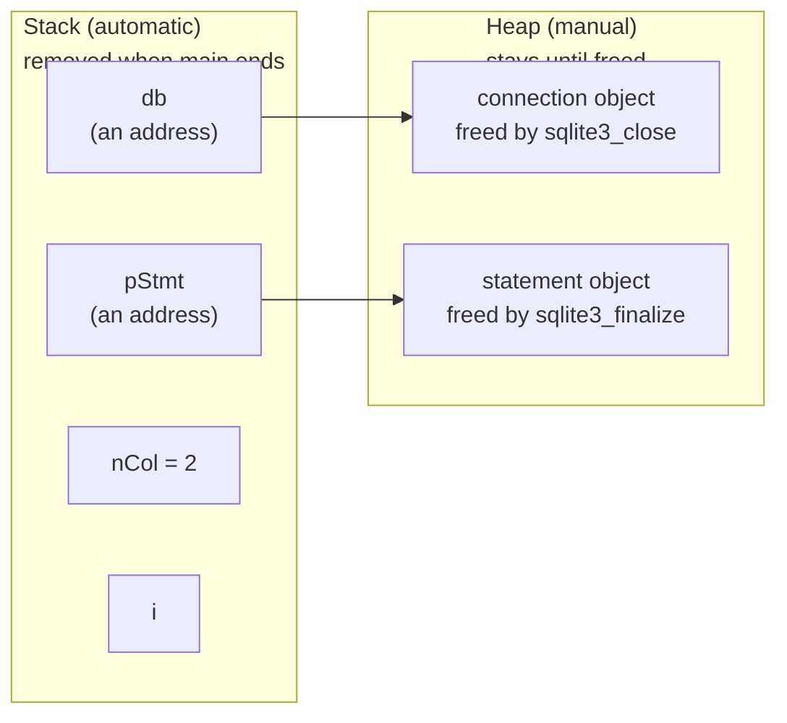

On the slide:

- `db`, `pStmt`, `nCol` and `i` are on the **stack**. They're small: two addresses and two numbers.
- The objects they point to are on the **heap**, created by SQLite.

If you lose a heap object's address without freeing it, that memory sits there, unused, until the process ends. This is called a **memory leak**. In an app that runs for days (a phone app, a browser), the leaked memory keeps growing. In the end, the app becomes slow or crashes.

**You already know this from React.** A `useEffect` that starts something must clean it up:

```js
useEffect(() => {
  const id = setInterval(tick, 1000);  // start something
  return () => clearInterval(id);      // clean it up, or it keeps running forever
}, []);
```

Forget `clearInterval`, and the timer keeps running after the component is gone. That's a leak too.

On the slide, `sqlite3_finalize(pStmt)` and `sqlite3_close(db)` are the cleanup. They're this program's `return () => clearInterval(id)`.

**How C programs get and free heap memory.** The C standard library has two functions for it: **`malloc`** ("memory allocate") asks for a block of heap memory and gives back its address, and **`free`** gives it back. SQLite has its own memory functions (the public ones are called `sqlite3_malloc` and `sqlite3_free`) and uses them for you, inside `sqlite3_open`, `sqlite3_prepare`, `sqlite3_finalize` and `sqlite3_close`. The slide never calls them directly.

**Worse than a leak.** A leak only wastes memory. These three mistakes are worse, because C doesn't stop you, and each one is undefined behavior (chapter [6.5](#s6-5)): the program may seem fine, print nonsense, or crash.

- **Reading past the end of a list.** C never checks list positions. JavaScript gives you `undefined` for `process.argv[99]`. C just reads whatever bytes happen to be there. Tested: with 3 command-line words, `argv[3]` is the NULL end marker (section [6.10](#s6-10)), but `argv[5]` printed one of the process's **environment variables** (settings the OS gives every process, like `PATH`). That memory was never part of the list. **Writing** past the end of a list is called a **buffer overflow** (here "buffer" means any block of memory that holds data), and it's one of the most common security holes in C programs. That's why the real code checks `argc` first (chapter [10.5](#s10-5)).
- **Using memory after it's freed** ("use after free"). The address still looks like a normal address, but the memory may already hold something else. The rule in chapter [8.9](#s8-9), "the text from `sqlite3_column_text` is valid only until the next step", is there to stop exactly this.
- **Freeing twice** ("double free"), or using a statement after `sqlite3_finalize`. SQLite's header file calls this "a grievous error" that can cause "segfaults and heap corruption" (crashes and broken memory).

<a id="s6-21"></a>
### 6.21 `return 0;`

```c
  return 0;
}
```

`main` returns `0` to the OS. That becomes the **exit code** (chapter [4.5](#s4-5)), meaning "everything went fine". Same as `process.exit(0)` in Node. The `}` closes `main`, and the program ends.

<a id="s6-22"></a>
### 6.22 Cheat sheet: every C piece in this file

| C | Say it as | JavaScript / TypeScript | Section |
|---|---|---|---|
| `;` | end of statement (required) | `;` (optional in JS) | [6.2](#s6-2) |
| `/* ... */` | comment | same | [6.3](#s6-3) |
| `int` | whole number | `number` | [6.4](#s6-4) |
| `char` | one byte / one character | one-letter string | [6.4](#s6-4) |
| `unsigned` | no negative numbers | the `U` in `Uint8Array` | [6.4](#s6-4) |
| `void` | nothing | `void` | [6.12](#s6-12) |
| `int x;` | declare x | `let x;` (but C gives garbage, not `undefined`) | [6.5](#s6-5) |
| `const int x = 5;` | x can't be reassigned | `const x = 5;` | [6.6](#s6-6) |
| `const char *z` | z points to read-only text | (no direct match) | [6.6](#s6-6) |
| `'Q'` | one character (the number 81) | `"Q".charCodeAt(0)` | [6.7](#s6-7) |
| `"Queen"` | text with a hidden `\0` | `"Queen"` | [6.7](#s6-7) |
| `\n`, `\0` | new line, zero byte | `\n`, `\u0000` | [6.7](#s6-7) |
| `sizeof(x)` | how many bytes x takes | (no direct match) | [6.7](#s6-7) |
| `char *s` | s is a pointer to char (a string) | `let s; // string` | [6.8](#s6-8) |
| `&x` | address of x | (hidden in JS) | [6.9](#s6-9) |
| `*p` (in code) | go to the address in p | `memory[p]` | [6.9](#s6-9) |
| `char **argv` | list of strings | `string[]` | [6.10](#s6-10) |
| `sqlite3 **ppDb` | where to put the handle | a `useRef` that gets filled in for you | [6.10](#s6-10) |
| `static char a[] = "..."` | an array of chars that stays alive after the function ends | (no direct match) | [6.10](#s6-10) |
| `NULL` | address of nothing | `null` | [6.11](#s6-11) |
| `int f(int a);` | function declaration | a `.d.ts` entry | [6.12](#s6-12) |
| `int f(int a){ ... }` | function definition | `function f(a: number): number { ... }` | [6.12](#s6-12) |
| `main` | where the program starts | the top of your script | [6.13](#s6-13) |
| `argc`, `argv` | argument count, argument values | `process.argv` | [6.13](#s6-13) |
| `struct` | object with fixed fields | `interface` | [6.14](#s6-14) |
| `typedef` | short name for a type | `type X = ...` | [6.14](#s6-14) |
| `==`, `!=` | equal, not equal (on `char *`: same address) | `===`, `!==` | [6.15](#s6-15) |
| `strcmp(a, b) == 0` | the two texts have the same letters | `a === b` on strings | [6.15](#s6-15) |
| `a ? b : c` | if a then b else c | same | [6.15](#s6-15) |
| `printf` | print to stdout | `console.log` | [6.16](#s6-16) |
| `fprintf(stderr, ...)` | print to stderr | `console.error` | [6.16](#s6-16) |
| `%s`, `%d`, `%c`, `%p`, `%zu` | text, number, character, address, size holes | `${...}` | [6.16](#s6-16) |
| `#define X 100` | named constant (macro) | `const X = 100` | [6.17](#s6-17) |
| `#include <x.h>` | use a header file | `import` | [6.17](#s6-17) |
| `(const char*)value` | cast | `value as string` | [6.18](#s6-18) |
| `void *` | an address of any type | (no direct match) | [6.18](#s6-18) |
| `malloc`, `free` | get heap memory, give it back | (done for you by the garbage collector) | [6.20](#s6-20) |
| `return 0;` | end main with success | `process.exit(0)` | [6.21](#s6-21) |

**You now know**

- To read a C variable line, find the name, then read the symbols to its left.
- A **C statement** must end with `;`.
- A **type** says how many bytes a variable uses and what they mean. `int`, `char`, `unsigned`, `void`.
- **Declaration** creates a variable. **Assignment** gives it a value. New C variables hold **garbage** until assigned. Reading one before that, or breaking another C rule, is **undefined behavior**: C promises nothing about what happens.
- C's `const char *` means "pointer to read-only text", not "can't reassign".
- `'Q'` is one character (a number). `"Queen"` is a **string literal** with a hidden `\0`. The **operator** `sizeof` gives a size in bytes.
- `*` means "pointer" in a declaration and "go to the address" in code. `&x` means "address of x".
- `**` is a pointer to a pointer: a list of strings, or an **output parameter** ("where to put the answer"). An **array** is C's fixed list, and `static` keeps memory alive after a function ends.
- The four nulls: SQL NULL, JS null, the null terminator, the **NULL pointer**.
- **Function definition** (with a body) vs **function declaration** (no body, ends with `;`). **Parameters** and **arguments**.
- **`main`** is called first. `argc` is the count, `argv` is the list.
- **struct**, **fields**, **typedef**, **handle** (an **opaque pointer**). The prefixes `p`, `pp`, `n`, `z`, `rc`.
- `==` on two `char *` compares addresses. Compare text with **`strcmp`**.
- `printf` with a **format string** and **format specifiers**. `fprintf(stderr, ...)`. The **C standard library** and `stdio.h`. stdout is **buffered**, so text can be lost in a crash. stderr isn't.
- Lines starting with `#` are for the **preprocessor**. `#define` makes a **macro**. `#include` brings in a **header file**. **Linking** adds the library's code. With **shared libraries**, two functions with the same name can clash silently.
- A **cast** changes how the compiler treats a value.
- C has no **exceptions**. Functions return **status codes** (also called result codes or return codes), like HTTP status codes.
- The **JavaScript engine** (V8) has a **garbage collector** that frees unused objects. C has none.
- The **stack** is automatic memory. The **heap** is manual memory for things that must outlive a function. **`malloc`** gets heap memory and **`free`** gives it back. Forgetting causes a **memory leak**.
- Worse than a leak: reading or writing past the end of a list (a **buffer overflow**), using memory after it's freed, and freeing twice. C checks none of them.

[Back to the chapter list](#s0-6)

---

<a id="s7"></a>
## 7. How SQLite runs a query

You now have all the background. Let's see how SQLite works.

<a id="s7-1"></a>
### 7.1 SQLite's "interface"

The slide's title is **Interface**. Here, an **interface** means the list of functions a library lets you call. (This is **not** TypeScript's `interface` keyword from chapter [6.14](#s6-14). Same word, different meaning.)

You know this idea from backend work. The list of endpoints your Express API offers (`GET /users`, `POST /users`, ...) is that API's interface. Your React app uses only those endpoints. It doesn't care how the server works inside.

SQLite's interface, as shown on the slide:

| Function | What it does | In your CRUD world |
|---|---|---|
| `sqlite3_open` | open a database file | connect to the database |
| `sqlite3_prepare` | get one SQL statement ready to run | `db.prepare(sql)` in Node (explained below) |
| `sqlite3_column_count` | how many columns will each row have? | how many keys each row object will have |
| `sqlite3_step` | run until the next row is ready | "give me the next item" |
| `sqlite3_column_name` | the name of a column | an object's key |
| `sqlite3_column_text` | the value of a column, as text | an object's value |
| `sqlite3_finalize` | throw away a prepared statement | cleanup |
| `sqlite3_close` | close the database | close the connection |

<a id="s7-2"></a>
### 7.2 The two objects

SQLite's interface uses two main objects (both are structs, section [6.14](#s6-14)):

1. **The database connection** (type `sqlite3`). There's no server, so what does "connection" mean here? SQLite keeps this word from server databases. Here it simply means "one open database file, plus SQLite's settings and memory for it". Created by `sqlite3_open`, removed by `sqlite3_close`.
2. **The prepared statement** (type `sqlite3_stmt`). One SQL statement, prepared and ready to run. Created by `sqlite3_prepare`, removed by `sqlite3_finalize`.

One connection can have many statements. Each statement belongs to one connection.

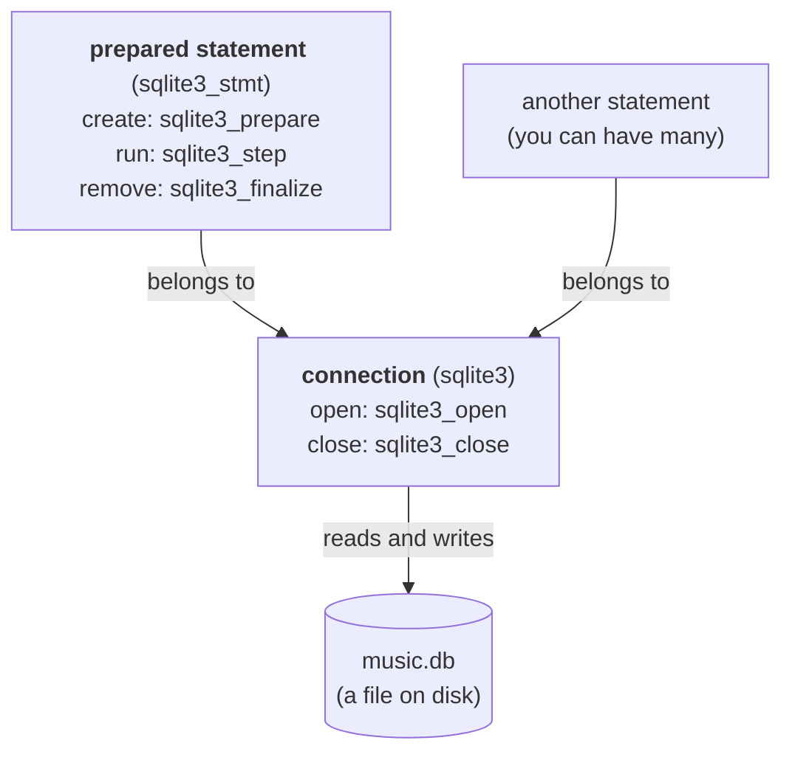

<a id="s7-3"></a>
### 7.3 Prepare: turning SQL into step-by-step instructions

When you write

```sql
SELECT name, artist FROM songs
```

you say **what** you want. You don't say **how** to get it. You didn't write "open the table, go to the first row, take the second column...". SQLite must decide those steps itself.

`sqlite3_prepare` does this. It reads your SQL and turns it into a list of very simple, step-by-step instructions.

This is also **compiling**. In general, compiling means "translating code into simpler instructions". In chapter [5](#s5), C was compiled into machine code for the CPU. Here, SQL is compiled into instructions for SQLite's own small engine (its **virtual machine**, chapter [7.5](#s7-5)).

This list of instructions is called **bytecode**. ("Byte" because each kind of instruction has a code number that fits in one byte. "Code" because it's a program.)

A comparison: SQL is like ordering "one masala dosa" in a restaurant. The bytecode is the kitchen's recipe card: "heat the pan, spread the batter, add the filling, fold, serve". You say **what** you want. Prepare writes the **recipe**.

**Prepare does NOT run your query.** It only writes the recipe. No row is read from the table yet.

How prepare works:

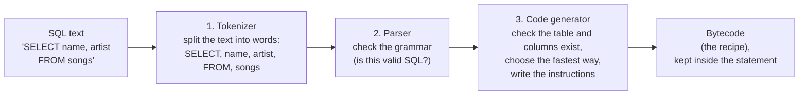

- The **tokenizer** splits the text into separate words and symbols. Each one is called a **token**.
- The **parser** checks the **syntax**: the grammar rules of the language. It's like TypeScript catching a missing bracket.
- The **code generator** checks that the table and columns really exist, decides the fastest way to get the data, and writes the bytecode.

Because of this, if your SQL has a typo or uses a table that doesn't exist, you find out **when prepare runs**, before anything else happens. Tested with `query`, the name of the working C program we build in chapter [10](#s10):

```text
$ ./query music.db "SELEC name FROM songs"
SQL error: near "SELEC": syntax error

$ ./query music.db "SELECT * FROM nope"
SQL error: no such table: nope
```

(The `$` at the start of a line is the terminal's **prompt**, where you type. Don't type the `$` itself. Lines without `$` are the output.)

Prepare checks that your SQL is **valid**. It does not check that it is **safe**. If you build SQL by gluing in text that a user typed, prepare compiles the user's text as SQL too. Chapter [11.1](#s11-1) shows this attack, called SQL injection, and the safe way to put user input into a query.

<a id="s7-4"></a>
### 7.4 You can see the bytecode

SQLite shows you the recipe if you put the word `EXPLAIN` before a query. This is the real output for our query, from `sqlite3 music.db "EXPLAIN SELECT name, artist FROM songs"` with SQLite 3.53.4. (Other versions may show slightly different numbers in the `p` columns.)

```text
addr  opcode         p1    p2    p3    p4             p5  comment
----  -------------  ----  ----  ----  -------------  --  -------------
0     Init           0     8     0                    0
1     OpenRead       0     2     0     3              0
2     Rewind         0     7     0                    0
3       Column         0     1     1                    0
4       Column         0     2     2                    0
5       ResultRow      1     2     0                    0
6     Next           0     3     0                    1
7     Halt           0     0     0                    0
8     Transaction    0     0     1     0              1
9     Goto           0     1     0                    0
```

The columns of this table:

- `addr` is the **instruction number** (not a memory address).
- `opcode` is the **instruction's name**. ("Op" = operation.)
- `p1` to `p5` are details for each instruction (which table, which column, where to jump). You can ignore them, except for one number used in section [7.7](#s7-7).
- The rows that are pushed to the right (3, 4, 5) are the **body of a loop**. The `sqlite3` program indents them to show that.

Here's what it says, **in the order it actually runs**:

| Order | addr | Instruction | Plain English |
|---|---|---|---|
| 1st | 0 | `Init` | Start. Jump to instruction 8. |
| 2nd | 8 | `Transaction` | Start a **transaction** for reading: a group of reads and writes that happens completely or not at all (chapter [7.8](#s7-8)). |
| 3rd | 9 | `Goto` | Jump to instruction 1. |
| 4th | 1 | `OpenRead` | Open the `songs` table for reading. |
| 5th | 2 | `Rewind` | Go to the first row. If there are no rows, jump to 7. |
| 6th | 3 | `Column` | Copy this row's `name` into a temporary slot (like a variable inside SQLite). |
| 7th | 4 | `Column` | Copy this row's `artist` into another temporary slot. |
| 8th | 5 | `ResultRow` | **A row is ready. Pause, and hand it to the program.** |
| 9th | 6 | `Next` | Move to the next row. If there is one, jump back to 3. |
| last | 7 | `Halt` | No more rows. Stop. |

Why does it jump to 8 and then back to 1? SQLite's code generator puts some setup steps at the end and jumps to them first. That's just how it builds the recipe. The result is the same.

Instructions 3 to 6 form a **loop**, like a `for` loop. And instruction 5, `ResultRow`, is where SQLite **pauses**. That pause is the key to `sqlite3_step`.

<a id="s7-5"></a>
### 7.5 The virtual machine

The part of SQLite that follows these instructions one by one is called the **virtual machine**. "Machine" because it works like a tiny CPU. It reads one instruction, does it, and moves to the next. "Virtual" because it's not a real chip. It's C code that pretends to be a simple CPU that understands SQLite's instructions.

You already run a virtual machine like this every day: Node. Its JavaScript engine, V8 (chapter [6.20](#s6-20)), first compiles your JavaScript into bytecode too. Then a part of V8 called **Ignition** runs that bytecode one instruction at a time, the same way SQLite's virtual machine runs its own. (V8 also turns code that runs very often into real machine code, to make it faster. SQLite doesn't do that.)

(In cloud hosting, "virtual machine" means something else: a rented computer, for example from AWS. That's a different meaning.)

<a id="s7-6"></a>
### 7.6 Step: get the next row

`sqlite3_step` tells the virtual machine: "run the recipe until you have a row for me".

1. It runs until it reaches `ResultRow` (instruction 5), then **pauses** and returns `SQLITE_ROW` (100). A row is ready.
2. You read the row.
3. You call `sqlite3_step` again. It **continues from where it paused**, moves to the next row, and pauses again at `ResultRow`.
4. When there are no more rows, it reaches `Halt` and returns `SQLITE_DONE` (101).

If you have written a JavaScript **generator function** (`function*`), this will feel familiar. `ResultRow` works like `yield`: it hands out one value, pauses, and continues from the same spot on the next call.

I wrote a small test program in C. It calls `sqlite3_step` again and again on our 3-song table. After each call, it prints what the call returned:

```text
step returned 100
step returned 100
step returned 100
step returned 101
```

Three rows, so 100 three times. Then 101.

**Try it in JavaScript.** Node has SQLite built in. It's called `node:sqlite`. You need **Node.js 24 or newer** for the examples in this file. Check your version with `node --version`. (Node 22.16 and later also work. Older versions either don't have it, or are missing some of the functions used here.) From Node 24.15 on, Node's documentation marks `node:sqlite` as a **release candidate**: the last stage before "stable". It works, and big changes are unlikely, but they are still allowed. Older Node 24 versions call it **experimental**.

First, some JavaScript ideas you may not have used:

- An **iterator** is an object that gives you one item each time you call its `.next()` method. Each call returns `{ done: false, value: item }`. When there are no more items, it returns `{ done: true }`. A `for...of` loop calls `.next()` for you.
- A file ending in `.mjs` is a JavaScript file that can use `import`. `import` and `require` (used in chapter [1](#s1)) both load code from somewhere else. They are two styles of doing the same thing.
- `node:sqlite` means "the `sqlite` module that is built into Node". No `npm install` is needed.
- `DatabaseSync` is the class for opening a database. `Sync` means each call waits until it is finished. There's no `await`. While a call waits, your Node process does nothing else. That's fine for the small, fast queries in this file. In a busy server, one slow query holds up every other request until it finishes.

Save this as `step.mjs`:

```js
import { DatabaseSync } from "node:sqlite";

const db = new DatabaseSync("music.db");
const stmt = db.prepare("SELECT name, artist FROM songs");
const rows = stmt.iterate();        // an iterator: one row per .next()

console.log(JSON.stringify(rows.next()));
console.log(JSON.stringify(rows.next()));
console.log(JSON.stringify(rows.next()));
console.log(JSON.stringify(rows.next()));

db.close();
```

Run `node step.mjs`. Output:

```text
{"done":false,"value":{"name":"Bohemian Rhapsody","artist":"Queen"}}
{"done":false,"value":{"name":"Hey Jude","artist":"The Beatles"}}
{"done":false,"value":{"name":"Untitled Demo","artist":null}}
{"done":true,"value":null}
```

(The last line also has `"value":null`. Node adds it. Only `done: true` matters.)

Compare:

| JavaScript `.next()` | C `sqlite3_step` |
|---|---|
| `{ done: false, value: row }` | returns `SQLITE_ROW` (100). Then you read the columns. |
| `{ done: true }` | returns `SQLITE_DONE` (101) |

Inside Node, every `rows.next()` **is** a call to `sqlite3_step`. Same thing.

**Why one row at a time?** Remember problem 1 from chapter [1.3](#s1-3): reading a whole 1-million-user file just to get one user. For a simple query like ours, SQLite never loads all results at once. Each step does **just enough work for one row**. A query like ours that matches a million rows still works on only one row at a time. (Some queries, like ones that sort with `ORDER BY`, may need to look at all matching rows before giving you the first one.) That's why SQLite works well on phones and small devices.

<a id="s7-7"></a>
### 7.7 Pages: how SQLite reads only part of the file

A disk can't read just one byte. It always reads a chunk of at least 512 bytes, and often 4,096. Reading 1 byte costs about the same as reading 4,096.

So SQLite divides the database file into equal chunks called **pages**. By default, each page is **4,096 bytes**. SQLite reads and writes the database mostly in whole pages. (A few small reads exist. For example, when it first opens a file, it reads just the first 100 bytes, the file's **header**, to learn the page size. This header is part of the database file. It has nothing to do with C's header files from chapter [6.17](#s6-17).)

(Careful: this "page" has nothing to do with a web page or with pagination in an API. It's just a chunk of the file.)

You can ask SQLite about its pages with a **PRAGMA**: a special SQLite command that reads or changes SQLite's own settings. Run it with the `sqlite3` program from chapter [1.4](#s1-4). Real output:

```text
$ sqlite3 music.db "PRAGMA page_size; PRAGMA page_count;"
4096
2
```

2 pages x 4,096 bytes = 8,192 bytes. That's exactly the file size we saw in chapter [2.3](#s2-3).

```text
music.db
+------------------------+------------------------+
|         page 1         |         page 2         |
|      bytes 0-4095      |    bytes 4096-8191     |
| starts with            | the songs table        |
| "SQLite format 3",     | (its rows)             |
| then the list of       |                        |
| tables                 |                        |
+------------------------+------------------------+
```

**Your numbers may be different.** Some builds of the `sqlite3` program turn on a setting called `auto_vacuum`, which keeps the file small when data is deleted. It needs one extra page for its own notes. With it on, you see **3 pages**, a file of **12,288 bytes**, and `songs` on **page 3** (so `OpenRead` shows `3` in column `p2`). The idea is exactly the same. The numbers in this file come from a standard `sqlite3`, built from SQLite's own source code with no settings changed.

The `OpenRead` instruction in the bytecode had a `2` in it (column `p2`). That's **page 2**, where the `songs` table starts. To answer our query, SQLite reads page 1 (to find where `songs` is) and page 2. In a big database with thousands of pages, reading only the needed pages saves a huge amount of work. That's how a database solves problem 1 from chapter [1.3](#s1-3).

<a id="s7-8"></a>
### 7.8 Transactions, the journal and locks

Remember problems 2 and 3 from chapter [1.3](#s1-3) (half-written files and lost updates)? Now that you know about pages, you can see how SQLite solves them.

A **transaction** is a group of reads and writes that happens **completely or not at all**. Every SQL statement runs inside one. (That's the `Transaction` instruction in the bytecode of [7.4](#s7-4).) Here's how SQLite makes a write happen completely or not at all:

1. Before changing any page of the file, SQLite saves a copy of the old page in a small side file, called the **journal** (for example `music.db-journal`).
2. It waits until the disk confirms the journal is really stored, and not just sitting in a memory cache on its way to the disk. (The OS function that does this wait is called `fsync`.) Only then does it touch the database file. If it skipped this wait, the disk might save the new pages **before** the old copies, and a power cut at the wrong moment would leave nothing to undo with.
3. It changes the database file, and again waits for the disk to confirm.
4. It deletes the journal. The change is now complete.

If the power goes off in the middle of step 3, the database file really is half written. But the journal still exists. The next program that reads the database sees the journal, puts the old pages back first, and only then reads. So nobody ever reads a half-written file. That solves problem 2.

A **lock** is a note that says "I'm using this file, others can't change it right now". While one connection is writing, no other connection can write at the same time. By default, the other connection doesn't wait. It gets `SQLITE_BUSY` (code 5, "busy, can't do this right now") straight away, and the program decides what to do, for example try again. (A program can also ask SQLite to wait and retry for a while, with a setting called a **busy timeout**.) Either way, two writers never change the file at the same time. That solves problem 3. If the second writer waits (with a busy timeout) or tries again, both inserts go in whole, and neither replaces the other. If it does neither, its insert fails with an error. Your code has to handle that error, but the first user is never overwritten.

**One trap remains, and it's in your code, not in SQLite.** Say your API reads a counter with one statement (`SELECT n FROM counters`), adds 1 in JavaScript, and writes the result back with a second statement. Two requests can both read 5, and both write 6. One update is lost, even though each statement on its own was safe. Two ways to fix it:

- Do the math inside one SQL statement: `UPDATE counters SET n = n + 1`.
- Put both statements in one transaction that you start with `BEGIN IMMEDIATE` and end with `COMMIT`. `BEGIN IMMEDIATE` takes the write lock at the start, so the second request gets `SQLITE_BUSY` (or waits, with a busy timeout) instead of reading the old value.

**Readers and the writer get in each other's way.** In this default way of writing, nobody can read while a writer is copying its changes into the database file (step 3). And a writer can't finish while someone is still in the middle of reading. By default nobody waits: whoever comes second gets `SQLITE_BUSY` straight away, unless it set a busy timeout. Tested: with one connection in the middle of reading, a second connection's `INSERT` failed at once with `database is locked`. For your API, that means a `GET` can fail while a `POST` is saving, and the other way round. The next part, WAL mode, removes most of this.

**A second way: WAL mode.** What you just read is SQLite's **default** way of writing, called the **rollback journal**. (Tested: a brand-new database made with SQLite 3.53.4 reports `PRAGMA journal_mode` as `delete`, which is this rollback journal.) SQLite has a second way, which a program can turn on with `PRAGMA journal_mode=WAL`. **WAL** stands for **write-ahead log**:

- Instead of copying old pages to a journal and changing the database file, SQLite writes the **new** pages to a side file called `music.db-wal`. Later, it copies them into the database file in one go. That copying step is called a **checkpoint**. SQLite also uses a small helper file, `music.db-shm`.
- The big benefit: people reading the database don't have to wait for a writer, and a writer doesn't have to wait for readers. Only two writers still can't write at the same time.

Many real apps turn WAL on, so if you see `-wal` and `-shm` files next to a database, that's what they are. The idea is the same as the journal: a crash in the middle never leaves a half-written database.

SQLite's own pages explain all of this in much more detail: [sqlite.org/atomiccommit.html](https://sqlite.org/atomiccommit.html) for the journal, [sqlite.org/lockingv3.html](https://sqlite.org/lockingv3.html) for locks, and [sqlite.org/wal.html](https://sqlite.org/wal.html) for WAL.

<a id="s7-9"></a>
### 7.9 The layers inside SQLite, and where the talk goes next

The slide shows the **outside** of SQLite: the functions your program calls. The talk's next slides open the box. Slide 18, "Ins & Outs", splits SQLite into two halves: a front half, `sqlite3_prepare()`, which compiles SQL into bytecode, and a back half, `sqlite3_step()`, which runs it. Slide 19, "The SQLite Stack", lists the parts inside: Parser, Code Generator, Virtual Machine, B-Tree, Pager and OS Interface. The slides after that take them one at a time.

SQLite's code is built as a stack of **layers**. (Here "stack" just means "a pile". It's not the stack memory from chapter [6.20](#s6-20).) Each layer only talks to the one directly below it. It's like your React app calling your Express API, which calls the database: each part only knows the part it calls.

You've already met most of the layers in this chapter. `sqlite3_prepare` uses the top ones. `sqlite3_step` uses the bottom ones. (The talk counts the tokenizer as part of the parser layer. The drawing below gives it its own box, to match chapter [7.3](#s7-3).)

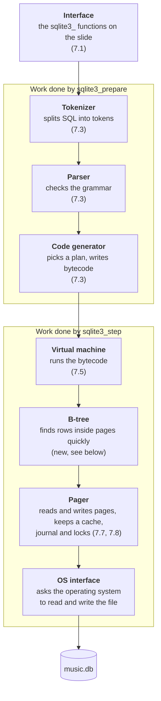

The B-tree is new. The pager and the OS interface are new names for work you met in chapters [7.7](#s7-7) and [7.8](#s7-8):

- **B-tree.** A **B-tree** is the way SQLite arranges rows inside pages so it can find one row quickly, without reading every page. Think of a big dictionary. To find "SQLite", you don't read from page 1. You jump to the "S" section, then to "SQ", and you're there in a few steps. A B-tree works the same way: a few pages act like index tabs that point to the right page, and each step jumps closer. Every table, like `songs`, is stored as one B-tree. The `OpenRead` instruction's page 2 (chapter [7.7](#s7-7)) is the start of the `songs` B-tree. (The "B" doesn't stand for anything you need to know. "Tree" is because each page points to more pages, branching like a tree.)
- **Pager.** The **pager** is the layer that reads and writes whole pages (chapter [7.7](#s7-7)). It keeps recently used pages in RAM so it doesn't have to read them from the slow disk again. A copy kept in fast memory like this is called a **cache**. The pager is also the layer that writes the journal and takes the locks from chapter [7.8](#s7-8). So it's the layer that keeps your data safe.
- **OS interface.** The lowest layer. It asks the operating system (chapter [4.2](#s4-2)) to open the file, read bytes, write bytes and lock the file. SQLite calls this layer the **VFS** (virtual file system). Because only this layer talks to the OS, SQLite can run on Linux, Windows, Android and many other systems by changing just this one layer.

**See the B-tree at work: SCAN and SEARCH.** The `songs` B-tree is sorted by `id`. So finding the song with `id = 2` is a quick jump, but finding the songs by Queen means reading every row. SQLite tells you which one it will do if you put **`EXPLAIN QUERY PLAN`** before a query. Try it on a copy of the database, so `music.db` stays the same for the rest of this file (`cp` copies a file):

```text
$ cp music.db test.db
$ sqlite3 test.db "EXPLAIN QUERY PLAN SELECT name FROM songs WHERE id = 2"
QUERY PLAN
`--SEARCH songs USING INTEGER PRIMARY KEY (rowid=?)
$ sqlite3 test.db "EXPLAIN QUERY PLAN SELECT name FROM songs WHERE artist = 'Queen'"
QUERY PLAN
`--SCAN songs
```

**SEARCH** means "jump through the B-tree to the right row". **SCAN** means "read every row, one by one". With 3 songs you can't feel the difference. With a million users, it's the difference between reading a few pages and reading all of them.

The fix is an **index**: a second B-tree, kept up to date by SQLite, sorted by the column you search on. (Careful: this is not the index of an array slot from chapter [3.1](#s3-1).)

```text
$ sqlite3 test.db "CREATE INDEX songs_artist ON songs(artist)"
$ sqlite3 test.db "EXPLAIN QUERY PLAN SELECT name FROM songs WHERE artist = 'Queen'"
QUERY PLAN
`--SEARCH songs USING INDEX songs_artist (artist=?)
```

Now the same query is a SEARCH. This is the practical reason to learn about B-trees: in your CRUD API, the columns you filter on in `WHERE` (like an email in a login route) usually need an index.

When the talk describes one of these layers, map it back to the slide. Ask yourself: "is this happening inside `prepare`, or inside `step`?"

**You now know**

- An **interface** is the list of functions a library offers, like your API's endpoints. (Not TypeScript's `interface`.)
- The two objects: the **database connection** (one open file) and the **prepared statement**.
- **Prepare** compiles SQL into **bytecode**, a step-by-step recipe, using a **tokenizer** (makes **tokens**), a **parser** (checks **syntax**) and a **code generator**. It doesn't run anything.
- In `EXPLAIN` output, `addr` is the instruction number and `opcode` is the instruction name.
- The **virtual machine** runs bytecode one instruction at a time, like **Ignition** inside V8.
- **Step** runs until the next row, pauses, returns 100 (`SQLITE_ROW`), and at the end returns 101 (`SQLITE_DONE`). It's like an **iterator**'s `.next()`, or `yield` in a **generator function**. In Node, `node:sqlite`'s `DatabaseSync` does this for you. It's a release candidate in Node 24.15 and later, and every call blocks until it's done.
- SQLite reads the file in **pages** of 4,096 bytes, and only the pages it needs. A **PRAGMA** reads or changes SQLite settings.
- A **transaction** happens completely or not at all. The **journal** keeps old pages so a half-finished write can be undone, and SQLite waits for the disk (`fsync`) after writing the journal and again after changing the file. A **lock** stops two writers from changing the file at once. The second writer gets `SQLITE_BUSY`, or waits if you set a **busy timeout**. This default way is the **rollback journal**. Reading a value and writing it back in two separate statements can still lose an update: do the math in SQL, or use `BEGIN IMMEDIATE`.
- **WAL** mode writes new pages to a `-wal` file and copies them back in a **checkpoint**.
- SQLite is built in **layers**: interface, tokenizer, parser, code generator, virtual machine, **B-tree** (finds rows quickly), **pager** (pages, **cache**, journal, locks) and **OS interface** or **VFS** (talks to the operating system).
- `EXPLAIN QUERY PLAN` shows **SEARCH** (jump through a B-tree) or **SCAN** (read every row). An **index** is an extra B-tree that turns a SCAN into a SEARCH.

[Back to the chapter list](#s0-6)

---

<a id="s8"></a>
## 8. The slide, line by line

You now know every symbol on the slide. Let's read it. (The line numbers count every line of the slide, including the empty line 5.)

<a id="s8-1"></a>
### 8.1 Line 1

```c
int main(int argc, char **argv){
```

The program starts here (chapter [6.13](#s6-13)). When the program starts, `main` is called first. `argv[1]` will be the database file name, and `argv[2]` will be the SQL. `main` will return an `int`, the exit code.

**In JS:** `const [, , file, sql] = process.argv;` (Each empty spot between commas skips one item: the first skips the node path, the second skips the script path.)

<a id="s8-2"></a>
### 8.2 Lines 2 to 4

```c
  sqlite3 *db;            /* Database connection */
  sqlite3_stmt *pStmt;    /* One SQL statement */
  int nCol;               /* Number of columns in the result set */
```

Three **declarations** (chapter [6.5](#s6-5)). Read them out loud (chapter [6.1](#s6-1)):

| Line | Read it as | Will hold |
|---|---|---|
| `sqlite3 *db;` | db is a pointer to a `sqlite3` | the **handle** of the database connection |
| `sqlite3_stmt *pStmt;` | pStmt is a pointer to a `sqlite3_stmt` | the **handle** of the prepared statement |
| `int nCol;` | nCol is an int | how many columns each row has |

These variables have **no value assigned yet**. In C, that means they hold garbage, leftover bytes (chapter [6.5](#s6-5)), until the next lines assign them. The text between `/*` and `*/` is a comment.

**In JS:** `let db; let pStmt; let nCol;`

<a id="s8-3"></a>
### 8.3 Line 5

Empty. It's there to make the code easier to read.

<a id="s8-4"></a>
### 8.4 Line 6

```c
  db = sqlite3_open(argv[1]);
```

"Open the file named by the first word after the program's name (`argv[1]`, which is `music.db`), and store the connection's handle in `db`."

SQLite opens the file and reads its first 100 bytes (the file's header) to learn the page size. It creates the connection object on the heap (chapter [6.20](#s6-20)) and gives back its address. It does **not** check the `SQLite format 3` text yet. That check (chapter [2.3](#s2-3)) happens later, the first time SQLite really reads the file, which is during prepare. (Tested two ways. First, a tool called `strace`, which lists every file read a program makes, showed `sqlite3_open` reading exactly 100 bytes of `music.db` before it returned. The full 4,096-byte read of page 1 only came during prepare. Second, opening a file full of random bytes succeeded, and the error `file is not a database` only came at prepare. So open reads the header, but doesn't check it.)

If the file **doesn't exist**, SQLite **creates a new, empty one**. Tested: running `./query brand_new.db "SELECT 1+1 AS answer"` printed `answer = 2` and created a new file of 0 bytes. (`SELECT 1+1 AS answer` needs no table. SQLite just does the math. `AS answer` gives the result column the name `answer`.)

**In JS:** `const db = new DatabaseSync(file);`

<a id="s8-5"></a>
### 8.5 Line 7

```c
  pStmt = sqlite3_prepare(db, argv[2]);
```

"Using connection `db`, compile the SQL from the second argument into bytecode, and store the statement's handle in `pStmt`."

This is the tokenizer, parser and code generator from chapter [7.3](#s7-3). Nothing runs yet. Typos and missing tables are caught here.

**In JS:** `const stmt = db.prepare(sql);`

<a id="s8-6"></a>
### 8.6 Line 8

```c
  nCol = sqlite3_column_count(pStmt);
```

"How many columns will each result row have?" For `SELECT name, artist FROM songs`, the answer is `2`.

SQLite knows this **before reading any row**, because when it compiled the SQL, it already found out which columns the result will have.

**In JS:** `const nCol = stmt.columns().length;`

<a id="s8-7"></a>
### 8.7 Line 9

```c
  while( sqlite3_step(pStmt)==SQLITE_ROW ){
```

"Run the recipe until the next row is ready. If a row is ready (100), run the loop body. Then repeat."

When `step` returns `SQLITE_DONE` (101), the check `101 == 100` is false, and the loop stops (chapter [7.6](#s7-6)).

Before compiling, the preprocessor turns `SQLITE_ROW` into `100` (chapter [6.17](#s6-17)). So the compiler really sees `sqlite3_step(pStmt)==100`.

**In JS:** `for (const row of stmt.iterate()) {`

<a id="s8-8"></a>
### 8.8 Lines 10 and 11

```c
    int i;
    printf("Row:\n");
```

Create the counter `i` for the inner loop (chapter [6.15](#s6-15)). Print `Row:` and a new line (chapter [6.16](#s6-16)).

**In JS:** `let i; console.log("Row:");`

<a id="s8-9"></a>
### 8.9 Lines 12 to 17

```c
    for(i=0; i<nCol; i++){
      printf("  %s = %s\n",
        sqlite3_column_name(pStmt, i),
        sqlite3_column_text(pStmt, i)
      );
    }
```

"For each column number `i`, from 0 up to `nCol - 1`, print its name and its value."

- `sqlite3_column_name(pStmt, i)` gives the **name** of column `i`, like `"artist"`. It returns a `const char *`: an address of read-only text.
- `sqlite3_column_text(pStmt, i)` gives the **value** of column `i` in the **current row**, as text, like `"Queen"`. It returns a `const unsigned char *`: an address of read-only bytes (chapter [6.18](#s6-18)), holding UTF-8 text (chapter [2.2](#s2-2)).

`_text` means "give me this value **as text**", whatever it really is. The `year` column holds the whole number 1975, and `sqlite3_column_text` turns it into the text `"1975"` for you. SQLite has other functions for other types: `sqlite3_column_int` gives a whole number, and `sqlite3_column_type` tells you which type the value really has. The slide uses `_text` for everything, because it only prints.

Columns are counted from **0**, like JavaScript arrays.

`printf` fills the two `%s` holes. For each one, it follows the address and prints until the 0 byte, like our `readString` in chapter [3.3](#s3-3).

**The text from `sqlite3_column_text` is valid only until the next `step`, `reset` or `finalize`** (or until you ask for the same column as a different type). (`sqlite3_reset` rewinds a statement so it can run again.) After that, SQLite may free that memory or reuse it for something else. If you kept the old address and read it later, you might get wrong text, or the program might crash. That's the "use after free" mistake from chapter [6.20](#s6-20). So use the text right away. If you need to keep it for later, make your own copy first.

**One more limit: binary data.** A column can also hold raw bytes instead of text, for example an image. SQLite calls this a **BLOB** (binary large object). Raw bytes can contain the byte 0 in the middle. `printf("%s")` stops at the first 0 byte (chapter [3.2](#s3-2)), so it would print only the start, and not tell you. To know the real length of a column's data, C code calls `sqlite3_column_bytes(pStmt, i)`. Our `songs` table has only text and numbers, so the slide is fine for it.

**In JS:**

```js
const columns = stmt.columns();      // once, before the loop
// ...inside the loop:
for (const col of columns) {
  console.log(`  ${col.name} = ${row[col.name]}`);
}
```

(This JavaScript is a close match, not an exact one. Node gives each value its real type instead of text. Chapter [11](#s11) shows the differences.)

The `}` on line 17 closes the `for` loop.

<a id="s8-10"></a>
### 8.10 Line 18

```c
  }
```

This `}` closes the `while` loop. When the `while` ends, all rows have been printed.

<a id="s8-11"></a>
### 8.11 Lines 19 and 20

```c
  sqlite3_finalize(pStmt);
  sqlite3_close(db);
```

Cleanup (chapter [6.20](#s6-20)). C has no garbage collector, so we free the heap objects ourselves.

- `sqlite3_finalize(pStmt)` removes the prepared statement.
- `sqlite3_close(db)` closes the connection and releases the file.

**The order matters.** Every statement belongs to a connection, so statements must be removed first. A test program tried closing too early:

```text
close before finalize returned 5
close after finalize returned 0
```

While a statement still existed, `sqlite3_close` refused, left the connection open, and returned 5 (`SQLITE_BUSY`, "busy, can't do this right now"). Nobody else was using the file. Here "busy" means "this connection is still in use by a statement". After `finalize`, it closed and returned 0 (`SQLITE_OK`).

(SQLite also has a newer version, `sqlite3_close_v2`, just like `sqlite3_prepare_v2`, the newer prepare in chapter [10.3](#s10-3). If statements still exist, it doesn't refuse. It marks the connection as closed, and SQLite frees it automatically once the last statement is finalized. SQLite's header file says it's meant for languages with a garbage collector, where you can't control the order things are cleaned up. Node's `db.close()` uses it. In plain C, finalizing first and then calling `sqlite3_close`, like the slide does, is the clear way.)

**In JS:** `db.close();` (In Node, `db.close()` first finalizes every statement that is still open, then closes the connection. You never call finalize yourself.)

<a id="s8-12"></a>
### 8.12 Lines 21 and 22

```c
  return 0;
}
```

End `main` with exit code `0`, meaning success (chapter [6.21](#s6-21)). The `}` closes `main`.

**In JS:** `process.exit(0);`

That was the last line. You can now read every character of the slide, and you know what each one makes the computer do, down to the pages of the file.

[Back to the chapter list](#s0-6)

---

<a id="s9"></a>
## 9. The whole run, start to finish

Imagine the slide worked exactly as written, compiled into a program called `query`. (It doesn't quite work as written. Chapter [10](#s10) shows why. The outputs below come from the working version in chapter [10](#s10).)

We run:

```bash
./query music.db "SELECT name, artist FROM songs"
```

<a id="s9-1"></a>
### 9.1 As a flowchart

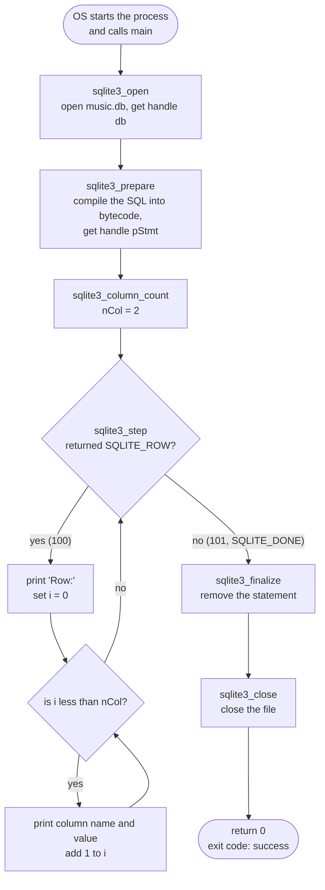

<a id="s9-2"></a>
### 9.2 As a conversation

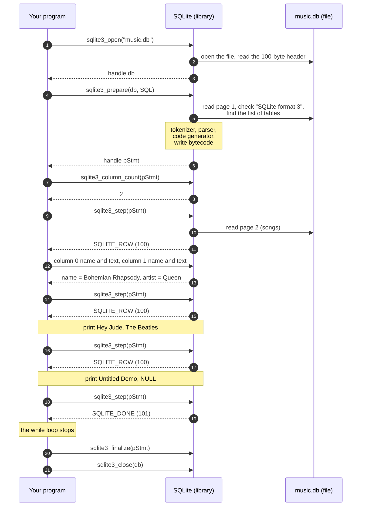

<a id="s9-3"></a>
### 9.3 As a table of values

| Moment | `nCol` | `step` returned | `i` | Printed |
|---|---|---|---|---|
| after `column_count` | 2 | | | |
| 1st step | 2 | 100 | | `Row:` |
| | 2 | | 0 | `  name = Bohemian Rhapsody` |
| | 2 | | 1 | `  artist = Queen` |
| | 2 | | 2 | *(2 is not less than 2, inner loop ends)* |
| 2nd step | 2 | 100 | | `Row:` |
| | 2 | | 0 | `  name = Hey Jude` |
| | 2 | | 1 | `  artist = The Beatles` |
| | 2 | | 2 | *(inner loop ends)* |
| 3rd step | 2 | 100 | | `Row:` |
| | 2 | | 0 | `  name = Untitled Demo` |
| | 2 | | 1 | `  artist = NULL` *(only the working version prints this safely. See [10.4](#s10-4).)* |
| | 2 | | 2 | *(inner loop ends)* |
| 4th step | 2 | 101 | | *(101 is not 100, so the while loop ends)* |
| finalize, close, `return 0` | | | | |

The output of the working version:

```text
Row:
  name = Bohemian Rhapsody
  artist = Queen
Row:
  name = Hey Jude
  artist = The Beatles
Row:
  name = Untitled Demo
  artist = NULL
```

[Back to the chapter list](#s0-6)

---

<a id="s10"></a>
## 10. Why the slide says "Pseudo-code"

<a id="s10-1"></a>
### 10.1 Proof: the compiler rejects it

I put the whole slide into a file called `slide.c`, with 3 extra lines at the top (two `#include` lines and an empty line), and compiled it:

```text
slide.c:9:8: error: too few arguments to function 'sqlite3_open'
slide.c:10:11: error: too few arguments to function 'sqlite3_prepare'
```

Line 9 of the file is line 6 of the slide (6 + 3 extra lines). Line 10 is slide line 7. The compiler checked the calls against SQLite's header file (chapter [6.17](#s6-17)), and found that both functions need more arguments. Just like TypeScript saying `Expected 2 arguments, but got 1`.

<a id="s10-2"></a>
### 10.2 What the real `sqlite3_open` wants

This is the real declaration (chapter [6.12](#s6-12)) of `sqlite3_open`, from SQLite's header file `sqlite3.h`. (In the header, there's also a word `SQLITE_API` in front. By default it is an empty marker that does nothing, so it's left out here.)

```c
int sqlite3_open(
  const char *filename,   /* Database filename (UTF-8) */
  sqlite3 **ppDb          /* OUT: SQLite db handle */
);
```

Read it with what you know:

- `int` first: it **returns a status code** (chapter [6.19](#s6-19)), not the handle. `SQLITE_OK` (0) means it worked.
- `const char *filename`: the file name, as read-only text (chapter [6.6](#s6-6)).
- `sqlite3 **ppDb`: a pointer to a pointer. This is **job 2** from chapter [6.10](#s6-10): "tell me where to put the handle". `OUT` in the comment means it's an **output parameter**.
- It ends with `);` and has no `{ }` body, because it's a **declaration**, not a definition.
- `(UTF-8)` in the comment means SQLite expects the file name as UTF-8 bytes (chapter [2.2](#s2-2)). For English letters, that's the same as ASCII.

So the real call is:

```c
sqlite3 *db;                          /* db holds garbage for now */
int rc = sqlite3_open("music.db", &db);
/* &db = "the address where my variable db lives".
   SQLite writes the handle there.
   rc = "return code", tells us if it worked. */
if( rc!=SQLITE_OK ){                  /* != means "not equal" */
  /* it failed */
}
/* now db holds the handle */
```

In memory: say the variable `db` lives at addresses 20 to 27 (8 bytes, because an address takes 8 bytes, chapter [3.6](#s3-6)). We give SQLite the number 20. SQLite writes the 8 bytes of the handle into addresses 20 to 27. When we then read `db`, the handle is there. That's exactly the simulation from chapter [6.10](#s6-10).

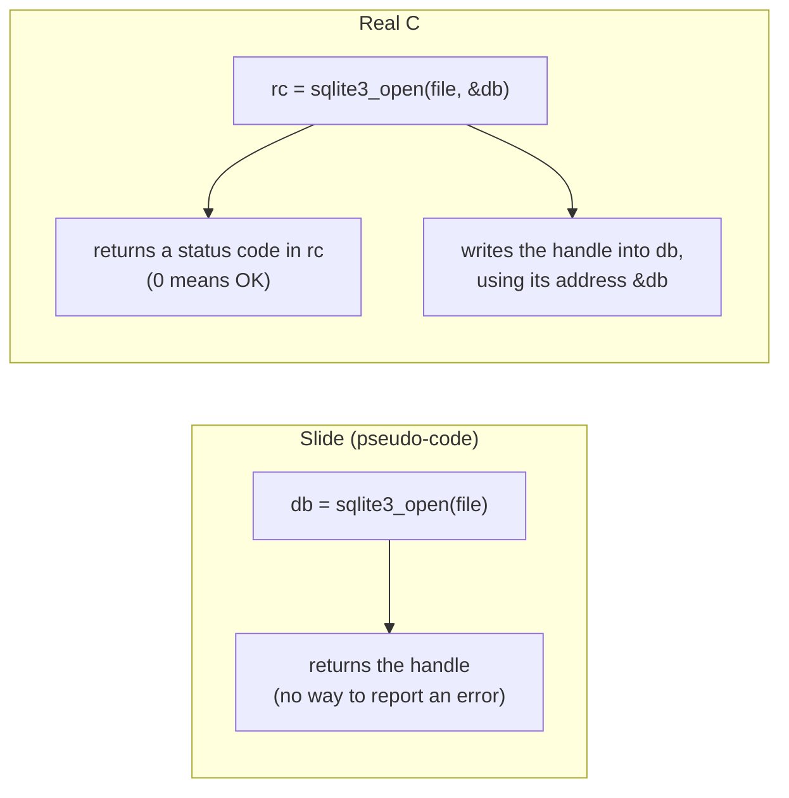

<a id="s10-3"></a>
### 10.3 The real prepare: `sqlite3_prepare_v2`

```c
rc = sqlite3_prepare_v2(db, argv[2], -1, &pStmt, NULL);
```

| Argument | What we pass | Why |
|---|---|---|
| 1 | `db` | which connection to use |
| 2 | `argv[2]` | the SQL text |
| 3 | `-1` | the length of the SQL. `-1` means "I'm not giving a length. Read until the 0 byte." (chapter [3.2](#s3-2)) |
| 4 | `&pStmt` | the address of our `pStmt` variable. SQLite writes the statement's handle there. |
| 5 | `NULL` | an optional extra we don't need. A NULL pointer (chapter [6.11](#s6-11)) means "nothing", like passing `null` in JavaScript. (Prepare only compiles the **first** SQL statement in the text. If you give an address here, SQLite writes where the rest of your text starts.) |

**Why `_v2`?** The first version, `sqlite3_prepare`, had design problems. For example, with a statement made by the old prepare, when a query failed, `step` returned only a general error, `SQLITE_ERROR`, and you needed an extra call to find out what went wrong. SQLite's documentation for `sqlite3_step` ([sqlite.org/c3ref/step.html](https://sqlite.org/c3ref/step.html)) says about this: "We admit that this is a goofy design." (Goofy = silly.)

But SQLite has a rule: **never break programs that already exist**. That's **compatibility**: new versions must keep old programs working. So instead of changing the old function, they added a new one, `sqlite3_prepare_v2`, and kept the old one working. SQLite's documentation for prepare ([sqlite.org/c3ref/prepare.html](https://sqlite.org/c3ref/prepare.html)) says: "The sqlite3_prepare() interface is legacy and should be avoided." (**Legacy** = old, kept only so that old programs still work.) You can see the compatibility idea from the talk right in the function's name.

<a id="s10-4"></a>
### 10.4 The NULL problem the slide hides

Song 3 has no artist. In the database, its value is SQL NULL. For a SQL NULL, `sqlite3_column_text` gives back a **NULL pointer**: an address of nothing (chapter [6.11](#s6-11)).

The slide passes that straight to `printf("%s")`. But `%s` means "go to this address and print until a 0 byte". There's nothing at that address. **C doesn't promise what happens.**

Here's a real test with two tiny programs. They are the same except for one line:

```c
#include <stdio.h>
int main(void){
  const char *s = NULL;
  printf("value = %s\n", s);    /* in null2.c, this line is: printf("%s\n", s); */
  return 0;
}
```

| Program | The `printf` line | What happened |
|---|---|---|
| `null1.c` | `printf("value = %s\n", s);` | printed `value = (null)` |
| `null2.c` | `printf("%s\n", s);` | the program crashed: `Segmentation fault` |

A **segmentation fault** is when the OS stops a program because it tried to touch memory it's not allowed to touch. It's a crash.

**The real problem is the same in both programs.** The C rules say you must never give `%s` a NULL pointer. Code that breaks a rule like this has **undefined behavior**: the language makes no promise at all about what happens. It may work, print nonsense, or crash, and a tiny change can switch between them. Both programs have this bug. One of them just got lucky.

Why did they behave differently on this computer? When the format string is exactly `"%s\n"`, gcc quietly replaces `printf` with a simpler, faster print function called `puts`. The C library on this Linux laptop (glibc) has a `printf` that happens to check for NULL and print `(null)`. `puts` doesn't check, so it tries to read address 0 and crashes. (I confirmed this by looking at the compiled programs: `null2` calls `puts`, `null1` calls `printf`.) On another computer or with another compiler, either program might crash, or neither. That's what "no promise" means.

The fix doesn't depend on any of this. The working version checks for NULL first, and prints the word `NULL` itself.

<a id="s10-5"></a>
### 10.5 The real, working program

This compiles and runs. Every C output in this file came from it, or from the small test programs described along the way. I named it `query`.

```c
#include <stdio.h>      /* use the C standard library's printing functions */
#include <sqlite3.h>    /* use SQLite's functions */

int main(int argc, char **argv){
  sqlite3 *db;           /* Database connection */
  sqlite3_stmt *pStmt;   /* One SQL statement */
  int nCol;              /* Number of columns in the result set */
  int rc;                /* rc = "return code", the status code from each call */

  if( argc!=3 ){
    fprintf(stderr, "Usage: %s DATABASE SQL\n", argv[0]);
    return 1;
  }

  rc = sqlite3_open(argv[1], &db);
  if( rc!=SQLITE_OK ){
    fprintf(stderr, "Cannot open database: %s\n", sqlite3_errmsg(db));
    sqlite3_close(db);
    return 1;
  }

  rc = sqlite3_prepare_v2(db, argv[2], -1, &pStmt, NULL);
  if( rc!=SQLITE_OK ){
    fprintf(stderr, "SQL error: %s\n", sqlite3_errmsg(db));
    sqlite3_close(db);
    return 1;
  }
  if( pStmt==NULL ){     /* the text had no SQL in it, for example "" */
    fprintf(stderr, "No SQL statement found\n");
    sqlite3_close(db);
    return 1;
  }

  nCol = sqlite3_column_count(pStmt);

  while( (rc = sqlite3_step(pStmt))==SQLITE_ROW ){
    int i;
    printf("Row:\n");
    for(i=0; i<nCol; i++){
      const char *zName = sqlite3_column_name(pStmt, i);
      const char *zVal = (const char*)sqlite3_column_text(pStmt, i);
      printf("  %s = %s\n",
        zName ? zName : "?",
        zVal ? zVal : "NULL"
      );
    }
  }

  if( rc!=SQLITE_DONE ){
    fprintf(stderr, "Step error: %s\n", sqlite3_errmsg(db));
  }

  sqlite3_finalize(pStmt);
  sqlite3_close(db);
  return rc==SQLITE_DONE ? 0 : 1;
}
```

Now, piece by piece. Everything new is explained here.

**The top two lines.**

```c
#include <stdio.h>
#include <sqlite3.h>
```

Bring in the declarations of the C standard library's input/output functions (`printf`, `fprintf`, `stderr`) and of SQLite's functions (chapter [6.17](#s6-17)). Like two `import` lines.

**The new variable.**

```c
  int rc;
```

`rc` = "return code". It will hold the status code from each SQLite call.

**Checking the arguments.**

```c
  if( argc!=3 ){
    fprintf(stderr, "Usage: %s DATABASE SQL\n", argv[0]);
    return 1;
  }
```

"If the number of command-line words is not 3 (the program's name plus 2 words), print a help message to stderr and end with exit code 1 (failure)."

"Usage:" is the usual way command-line programs tell you how to run them. `argv[0]` is the program's own name. Real test, running `./query` with no words:

```text
Usage: ./query DATABASE SQL
```

**Opening, with a check.**

```c
  rc = sqlite3_open(argv[1], &db);
  if( rc!=SQLITE_OK ){
    fprintf(stderr, "Cannot open database: %s\n", sqlite3_errmsg(db));
    sqlite3_close(db);
    return 1;
  }
```

- Open the file. SQLite writes the handle into `db` through `&db`. The status code goes into `rc`.
- If it's not `SQLITE_OK`, print the error and stop.
- `sqlite3_errmsg(db)` gives a readable error message, like JavaScript's `err.message`.
- Why close something that failed to open? Even when opening fails, SQLite usually still creates a connection object (so that `sqlite3_errmsg` can tell you what went wrong). We must free it, or it leaks.

**Preparing, with a check.**

```c
  rc = sqlite3_prepare_v2(db, argv[2], -1, &pStmt, NULL);
  if( rc!=SQLITE_OK ){
    fprintf(stderr, "SQL error: %s\n", sqlite3_errmsg(db));
    sqlite3_close(db);
    return 1;
  }
```

Compile the SQL (chapter [10.3](#s10-3)). If it fails (a typo, a missing table), print SQLite's message and stop. This is where `SQL error: near "SELEC": syntax error` came from.

**A prepare that works but gives back nothing.**

```c
  if( pStmt==NULL ){     /* the text had no SQL in it, for example "" */
    fprintf(stderr, "No SQL statement found\n");
    sqlite3_close(db);
    return 1;
  }
```

Prepare can return `SQLITE_OK` and still leave `pStmt` as a NULL pointer. That happens when the text has no SQL in it: an empty string, or only a SQL comment (`-- like this`). There is nothing to run, so SQLite gives back no statement. Without this check, the program would pass NULL to `sqlite3_step`. Real test, before this check was added: `./query music.db ""` printed the confusing `Step error: not an error`. With the check:

```text
$ ./query music.db ""
No SQL statement found
```

**The loop, saving step's answer.**

```c
  while( (rc = sqlite3_step(pStmt))==SQLITE_ROW ){
```

Call `step`, store its answer in `rc`, then compare with `SQLITE_ROW` (chapter [6.15](#s6-15)). We keep the answer in `rc` so we can check it **after** the loop.

**Getting the value safely.** This one line has many ideas in it. Here they are, one at a time:

```c
      const char *zVal = (const char*)sqlite3_column_text(pStmt, i);
```

| Piece | Meaning | Section |
|---|---|---|
| `const char *zVal` | create zVal: a pointer to read-only text | [6.6](#s6-6) |
| `z` in `zVal` | naming hint: text ending with a zero byte | [6.14](#s6-14) |
| `=` | store into it... | [6.5](#s6-5) |
| `sqlite3_column_text(pStmt, i)` | ...the value of column i, which is a `const unsigned char *` | [8](#s8) |
| `(const char*)` | a cast: treat it as `const char *`, the type of `zVal` | [6.18](#s6-18) |

In JavaScript, roughly: `let zVal = columnText(i) as string | null;`

```c
        zVal ? zVal : "NULL"
```

"If `zVal` points to something, use it. If it's a NULL pointer (which counts as false), use the text `"NULL"` instead." This is the fix for chapter [10.4](#s10-4).

**The column name gets the same check.**

```c
      const char *zName = sqlite3_column_name(pStmt, i);
        ...
        zName ? zName : "?",
```

`sqlite3_column_name` can also return a NULL pointer. SQLite's header file says it does that if it runs out of memory while making the name. That almost never happens, but if it did, `printf("%s")` would have the same NULL problem as chapter [10.4](#s10-4). So the program checks it too, and prints `?` instead. The rule in C: **every pointer that might be NULL must be checked before you use it.**

**Checking how the loop ended.**

```c
  if( rc!=SQLITE_DONE ){
    fprintf(stderr, "Step error: %s\n", sqlite3_errmsg(db));
  }
```

The loop stops when `step` returns anything other than `SQLITE_ROW`. That's either `SQLITE_DONE` (all good) or an error code (something went wrong while reading). This checks which one.

**Cleanup and exit code.**

```c
  sqlite3_finalize(pStmt);
  sqlite3_close(db);
  return rc==SQLITE_DONE ? 0 : 1;
```

Free the statement, then the connection. Return exit code 0 if everything finished properly, otherwise 1. Real tests: good SQL gave exit code `0`. Bad SQL gave `1`.

<a id="s10-6"></a>
### 10.6 Slide vs real, side by side

| Slide (pseudo-code) | Real C |
|---|---|
| no `#include` lines | `#include <stdio.h>` and `#include <sqlite3.h>` |
| no check on `argc` | make sure the user gave 2 words |
| `db = sqlite3_open(argv[1]);` | `rc = sqlite3_open(argv[1], &db);` then check `rc` |
| `pStmt = sqlite3_prepare(db, argv[2]);` | `rc = sqlite3_prepare_v2(db, argv[2], -1, &pStmt, NULL);` then check `rc` |
| `sqlite3_column_text(pStmt, i)` straight into `printf` | cast it, and handle NULL |
| `sqlite3_column_name(pStmt, i)` straight into `printf` | handle NULL here too |
| assumes prepare always gives a statement | check that `pStmt` is not NULL (empty SQL) |
| loop ends, nothing checked | check if it ended with `SQLITE_DONE` or an error |
| always `return 0` | return 0 or 1, depending on success |

The steps are the same. The real version adds the safety checks that C makes you write by hand, because C has no exceptions and no garbage collector.

[Back to the chapter list](#s0-6)

---

<a id="s11"></a>
## 11. The same program in JavaScript

Node.js has SQLite built in, called `node:sqlite` (chapter [7.6](#s7-6)). No `npm install` needed. This code needs **Node 24 or newer** (it was tested on Node 24.21).

```js
// demo.mjs
import { DatabaseSync } from "node:sqlite";

const [, , file, sql] = process.argv;   // skip node's path and the script's path

const db = new DatabaseSync(file);      // sqlite3_open
const stmt = db.prepare(sql);           // sqlite3_prepare_v2
const columns = stmt.columns();         // the column names (length = sqlite3_column_count)

for (const row of stmt.iterate()) {     // sqlite3_step, until SQLITE_DONE
  console.log("Row:");
  for (const col of columns) {
    console.log(`  ${col.name} = ${row[col.name]}`);  // column_name and column_text
  }
}

db.close();                             // finalizes open statements, then sqlite3_close_v2
```

Run `node demo.mjs music.db "SELECT name, artist FROM songs"`. Output:

```text
Row:
  name = Bohemian Rhapsody
  artist = Queen
Row:
  name = Hey Jude
  artist = The Beatles
Row:
  name = Untitled Demo
  artist = null
```

Same result. JavaScript prints `null`, because Node turns SQL's NULL into JavaScript's `null`.

A bad query gives the same message as the C version, but as an exception (chapter [6.19](#s6-19)) that you can `catch`. When you run `node demo.mjs music.db "SELEC name FROM songs"`, you will see many lines. Look for this one:

```text
Error: near "SELEC": syntax error
```

The other lines show where in the code the error happened. That list is called a **stack trace**. (Careful: this "stack" is a list of the function calls that were running, not the stack memory from chapter [6.20](#s6-20), though the two are closely linked.) You can ignore it here.

| C (slide) | JavaScript (`node:sqlite`) |
|---|---|
| `sqlite3_open(file)` | `new DatabaseSync(file)` |
| `sqlite3_prepare(db, sql)` | `db.prepare(sql)` |
| `sqlite3_column_count(pStmt)` | `stmt.columns().length` |
| `while( sqlite3_step(pStmt)==SQLITE_ROW )` | `for (const row of stmt.iterate())` |
| `sqlite3_column_name(pStmt, i)` | `columns[i].name` |
| `sqlite3_column_text(pStmt, i)` | `row[col.name]` |
| `sqlite3_finalize(pStmt)` | done for you by `db.close()` |
| `sqlite3_close(db)` | `db.close()` |
| check status codes | errors are thrown, use `try` / `catch` |

**The table is a close match, not an exact one.** Two real differences:

- **Types.** `sqlite3_column_text` turns every value into text (chapter [8.9](#s8-9)). `row[col.name]` gives the real type instead: the year 1975 comes back as the JavaScript number `1975`, SQL NULL as `null`, and raw bytes (a BLOB) as a `Uint8Array`. The printed output looks the same only because `console.log` turns everything into text again.
- **Two columns with the same name.** A row in Node is an object, and an object can't have the same key twice. Real test:

```text
$ ./query music.db "SELECT 1 AS a, 2 AS a"
Row:
  a = 1
  a = 2
$ node demo.mjs music.db "SELECT 1 AS a, 2 AS a"
Row:
  a = 2
  a = 2
```

The C version reads columns by number, so it sees both. In Node, the second `a` overwrote the first, and the value 1 is gone. Give every column its own name (with `AS`) and the problem disappears.

<a id="s11-1"></a>
### 11.1 Putting user input into SQL safely

Our `query` program and `demo.mjs` run whatever SQL you type. That's fine for a learning tool you run yourself. **It is dangerous in a real API.**

Say your Express API takes an artist name from the user and builds the SQL by gluing text together:

```js
const sql = `SELECT name FROM songs WHERE artist = '${userInput}'`;   // DANGEROUS
```

A user can type text that **changes the SQL itself**. This is called **SQL injection**, and it's one of the most common security holes in web apps.

`prepare` does **not** protect you here. It compiles whatever SQL text it gets. If the attacker's text is part of that SQL, it gets compiled too.

The safe way is a **placeholder**: write `?` in the SQL where a value goes, and give the value separately. SQLite then treats the value as plain data, never as SQL. Giving the value to a placeholder is called **binding** it.

Real test, with the attacker typing `Queen' OR '1'='1`:

```js
import { DatabaseSync } from "node:sqlite";
const db = new DatabaseSync("music.db");
const userInput = "Queen' OR '1'='1";
// UNSAFE: user text pasted into the SQL
console.log("unsafe:", db.prepare(`SELECT name FROM songs WHERE artist = '${userInput}'`).all().length, "rows");
// SAFE: ? placeholder, value bound separately
console.log("safe:  ", db.prepare("SELECT name FROM songs WHERE artist = ?").all(userInput).length, "rows");
console.log("normal:", JSON.stringify(db.prepare("SELECT name FROM songs WHERE artist = ?").all("Queen")));
db.close();
```

Output:

```text
unsafe: 3 rows
safe:   0 rows
normal: [{"name":"Bohemian Rhapsody"}]
```

The unsafe version returned **all 3 songs**: the attacker's `OR '1'='1'` became part of the SQL, and `'1'='1'` is always true. The safe version looked for an artist literally named `Queen' OR '1'='1` and found none. With a normal value, the placeholder works as expected. (`.all(...)` runs the statement and returns all rows as an array. The values you pass to it fill the `?` placeholders in order.)

In C, the same thing is done with `sqlite3_bind_text(pStmt, 1, value, -1, SQLITE_TRANSIENT)` (and `sqlite3_bind_int` for numbers), called after prepare and before step. The `1` means "the first `?`".

Careful: placeholders are counted from **1**, but columns are counted from **0** (chapter [8.9](#s8-9)). The first `?` is number 1, while the first column of a row is number 0. Mixing them up fails without any noise. Tested: `sqlite3_bind_text(pStmt, 0, ...)` binds nothing and returns 25 (`SQLITE_RANGE`, "number out of range"). If the code doesn't check that return code, the `?` stays empty, SQLite treats an empty `?` as NULL, and the query quietly finds no rows.

**Rule: never glue user input into SQL text. Always use `?` placeholders.**

<a id="s11-2"></a>
### 11.2 Very large whole numbers

SQLite can store whole numbers up to about 9 quintillion (64-bit numbers). A JavaScript `number` can only hold whole numbers exactly up to 9,007,199,254,740,991 (`Number.MAX_SAFE_INTEGER`). So what happens if a column holds a bigger number? Real test:

```js
import { DatabaseSync } from "node:sqlite";
const db = new DatabaseSync(":memory:");      // ":memory:" = a database that lives only in RAM
const st = db.prepare("SELECT 9007199254740993 AS n");
try { console.log("default:", st.get()); } catch (e) { console.log("default threw:", e.code, e.message); }
st.setReadBigInts(true);
console.log("readBigInts:", st.get());
```

Output:

```text
default threw: ERR_OUT_OF_RANGE Value is too large to be represented as a JavaScript number: 9007199254740993
readBigInts: [Object: null prototype] { n: 9007199254740993n }
```

By default, `node:sqlite` refuses with an error instead of giving you a wrong number. After `st.setReadBigInts(true)`, it returns a **BigInt**, JavaScript's type for whole numbers of any size (written with an `n` at the end). (`.get()` runs the statement and returns the first row. Node prints `[Object: null prototype]` in front of the row object. You can ignore it.) Normal ids and counts are far below this limit, so you only need this for very large numbers.

<a id="s11-3"></a>
### 11.3 Your CRUD API from chapter 1, now on SQLite

Here is the users API from chapter [1](#s1) again, this time on SQLite. Save it as `server.js` in a folder where you have run `npm install express`:

```js
// server.js
const express = require("express");
const { DatabaseSync } = require("node:sqlite");

const db = new DatabaseSync("users.db");                         // sqlite3_open
db.exec("CREATE TABLE IF NOT EXISTS users(id INTEGER PRIMARY KEY, name TEXT NOT NULL)");

const insertUser = db.prepare("INSERT INTO users(name) VALUES (?)");   // prepare once...
const allUsers = db.prepare("SELECT id, name FROM users");

const app = express();
app.use(express.json());

app.post("/users", (req, res) => {
  const result = insertUser.run(req.body.name);                  // ...run many times
  res.status(201).json({ id: result.lastInsertRowid, name: req.body.name });
});

app.get("/users", (req, res) => {
  res.json(allUsers.all());
});

app.listen(3000);
```

New pieces:

- `db.exec(sql)` runs SQL that returns no rows. `CREATE TABLE IF NOT EXISTS` creates the table the first time and does nothing after that.
- `NOT NULL` makes SQLite refuse a user whose name is `null`. (If `name` is missing from the request body, Node refuses even earlier, because it can't bind `undefined`. Either way, Express answers with a 500 error.)
- `.run(...)` runs a statement that changes data. Its result has `lastInsertRowid`, the `id` SQLite gave the new row.

Real test. Start the server with `node server.js`, and in a second terminal send two `POST` requests:

```text
$ curl -X POST localhost:3000/users -H "Content-Type: application/json" -d '{"name":"Asha"}'
{"id":1,"name":"Asha"}
$ curl -X POST localhost:3000/users -H "Content-Type: application/json" -d '{"name":"Ravi"}'
{"id":2,"name":"Ravi"}
```

(`curl` sends an HTTP request from the terminal, like `fetch`. `-X POST` picks the method, `-H` adds an HTTP header (a third kind of "header", see chapter [13.2](#s13-2)), and `-d` is the request body.)

Now stop the server with `Ctrl+C`, start it again, and ask for the users:

```text
$ curl localhost:3000/users
[{"id":1,"name":"Asha"},{"id":2,"name":"Ravi"}]
```

The users survived the restart. Look at how this answers the three problems from chapter [1.3](#s1-3):

1. **Too slow.** Each `INSERT` changes a page or two, not the whole file. (Our `GET /users` still reads every user. A real API would add `WHERE` or `LIMIT`.)
2. **Broken files.** Each `INSERT` is a transaction, protected by the journal (chapter [7.8](#s7-8)).
3. **Lost updates.** If you run two copies of the server, SQLite's lock keeps their writes apart, and each insert goes in whole. One thing to add for that case: by default, the second writer doesn't wait. Tested: it throws an error, `database is locked` (code 5, `SQLITE_BUSY`). Open the database with a busy timeout, `new DatabaseSync("users.db", { timeout: 5000 })`, and it waits up to 5,000 milliseconds for its turn instead.

**Why prepare and step are separate.** The two `db.prepare` calls run **once**, when the server starts. Each request then only binds a new value and steps. Compiling SQL into bytecode takes work, so doing it once and running the result many times is faster. It's also why the `?` placeholder (chapter [11.1](#s11-1)) is safe: the bytecode is already written before the user's value arrives, so the value can't change it.

**One limit.** `DatabaseSync` blocks (chapter [7.6](#s7-6)): while a query runs, the server can't start on any other request. For small, fast queries like these that's fine. If you ever have slow queries, look for an async SQLite library, or move them to a worker thread.

<a id="s11-4"></a>
### 11.4 Every SQLite library runs the slide

`node:sqlite`, `better-sqlite3` (a popular npm package), Python's `sqlite3`, and Android's database code all run the real SQLite C library. Some carry their own copy inside them (`node:sqlite` and `better-sqlite3` do). Others use the copy that comes with the operating system (Android does, and so does Python on most Linux systems). Either way, their friendly functions call the functions from this slide for you: `sqlite3_open` (or its close relative `sqlite3_open_v2`), `sqlite3_prepare_v2` (or `_v3`), `sqlite3_step`, and the rest. If you understand this slide, you understand what every SQLite library is doing inside.

It goes beyond servers. React Native apps use SQLite through libraries like `expo-sqlite`. Browsers can run it too: SQLite publishes an official **WebAssembly** build ([sqlite.org/wasm](https://sqlite.org/wasm)), which is the same C code compiled to run inside a web page. (WebAssembly is a format that lets browsers run code compiled from languages like C.)

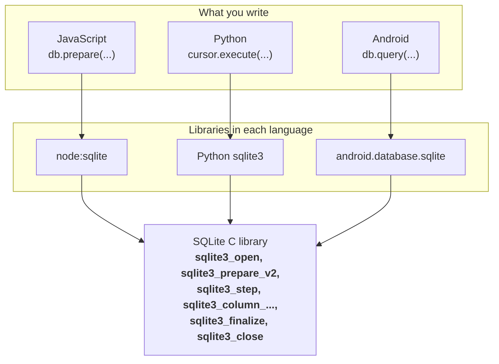

[Back to the chapter list](#s0-6)

---

<a id="s12"></a>
## 12. Try it yourself

Run these in your terminal, from this folder. First check that you have the two tools you need:

```bash
node --version       # needs v24 or newer
sqlite3 --version    # SQLite's command-line program
```

If `sqlite3` is missing, install it with `sudo apt install sqlite3`. (Section [12.4](#s12-4) explains `sudo` and `apt`.)

<a id="s12-1"></a>
### 12.1 Create `music.db`

If you haven't made `music.db` yet, run the command from chapter [1.4](#s1-4) in this folder. Here it is again:

```bash
sqlite3 music.db "CREATE TABLE songs(id INTEGER PRIMARY KEY, name TEXT, artist TEXT, year INTEGER);
INSERT INTO songs(name, artist, year) VALUES
  ('Bohemian Rhapsody', 'Queen', 1975),
  ('Hey Jude', 'The Beatles', 1968),
  ('Untitled Demo', NULL, NULL);"
```

Chapter [1.4](#s1-4) explains what each part of the SQL means.

<a id="s12-2"></a>
### 12.2 Look at things

```bash
sqlite3 music.db "SELECT * FROM songs"                    # see the data
sqlite3 music.db "EXPLAIN SELECT name, artist FROM songs" # see the bytecode
sqlite3 music.db "PRAGMA page_size; PRAGMA page_count;"   # see the pages
```

(In the terminal, everything after `#` is a comment. You can copy these lines as they are.)

<a id="s12-3"></a>
### 12.3 Run the JavaScript examples

Each file in this table is one code block from the chapter it names, except `memory.js`, which joins three blocks. Copy the code, save it under that name, and run it with `node`.

| File | Code from | Run with |
|---|---|---|
| `codes.js` | chapter [2.2](#s2-2) (the first block) | `node codes.js` |
| `header.js` | chapter [2.3](#s2-3) | `node header.js` |
| `memory.js` | chapters [3.1](#s3-1), [3.2](#s3-2) and [3.3](#s3-3) **together in one file** (3.2 and 3.3 use the `memory` from 3.1) | `node memory.js` |
| `args.js` | chapter [4.4](#s4-4) | `node args.js music.db "SELECT name FROM songs"` |
| `pointers.js` | chapter [6.9](#s6-9) (the JavaScript version) | `node pointers.js` |
| `open.js` | chapter [6.10](#s6-10) (the JavaScript simulation) | `node open.js` |
| `step.mjs` | chapter [7.6](#s7-6) | `node step.mjs` |
| `demo.mjs` | chapter [11](#s11) | `node demo.mjs music.db "SELECT name, artist FROM songs"` |
| `injection.mjs` | chapter [11.1](#s11-1) | `node injection.mjs` |
| `bigint.mjs` | chapter [11.2](#s11-2) | `node bigint.mjs` |
| `server.js` | chapter [11.3](#s11-3) (needs `npm install express` first) | `node server.js` |

Then try changing them:

```bash
node demo.mjs music.db "SELECT * FROM songs"
node demo.mjs music.db "SELECT name, year FROM songs WHERE year > 1970"   # WHERE keeps only matching rows
node demo.mjs music.db "SELEC name FROM songs"     # see the error from prepare
```

<a id="s12-4"></a>
### 12.4 (Optional) Run the C version

Save the working program from chapter [10.5](#s10-5) as `query.c`. If `gcc --version` fails, first run `sudo apt install build-essential`, which installs gcc.

**Always compile with warnings turned on.** All the `gcc` commands below include `-Wall -Wextra`. These two options tell gcc to warn you about suspicious code, like reading a variable before assigning it (chapter [6.5](#s6-5)) or mixing up pointer types (chapter [6.18](#s6-18)). Without them, gcc stays quiet about many mistakes. (On the laptop used for this file, with gcc 13, `query.c` and all of SQLite compiled with zero warnings. Another compiler or version may print a few warnings from inside `sqlite3.c` in option B. Those come from SQLite's code, not yours. Warnings that point at `query.c` are the ones to fix.)

The `apt` commands in this chapter are for Ubuntu and Debian, which is also what WSL gives you by default. Other Linux systems have their own installer (for example `dnf` on Fedora), with similar package names.

There are two ways to compile it. Pick one.

**Option A: install SQLite's developer package.** This is the usual way. You need `sudo` (explained below). (The package was not installed on the laptop used to write this file, so option B was used for the tests.)

```bash
sudo apt install libsqlite3-dev
gcc -Wall -Wextra query.c -lsqlite3 -o query
./query music.db "SELECT name, artist FROM songs"
```

What the pieces mean:

- `sudo` = run the next command as the administrator (it will ask for your password).
- `apt install` = install a system package. `apt` is Ubuntu's package installer, like `npm` but for the whole system.
- `libsqlite3-dev` = the SQLite library's "developer" package. The `-dev` packages contain the header files, and the link file that `-lsqlite3` looks for. You need both to compile programs.
- `gcc -Wall -Wextra query.c -lsqlite3 -o query` = compile `query.c` with warnings on, link (`-l`) the `sqlite3` library, and name the output (`-o`) `query` (chapter [6.17](#s6-17)).
- `./query ...` = run the program from this folder (chapter [5.2](#s5-2)).

**On a Mac**, `apt` doesn't exist. Install Apple's command-line tools instead, with `xcode-select --install`. They include a C compiler (on a Mac, `gcc` is really Apple's compiler, clang, under the same name) and SQLite's header and library. Then the `gcc` and `./query` lines above should work as they are. (Not tested on a Mac for this file.)

**Option B: download SQLite's source code.** No `sudo` needed. Every C test in this file that uses SQLite was built from this same SQLite source code, version 3.53.4.

SQLite's source code is published as one single, very large C file called the **amalgamation** ("amalgamation" means "many things joined into one"). It's `sqlite3.c`, about 270,000 lines, with `sqlite3.h` next to it. You compile it together with your own program:

```bash
curl -LO https://www.sqlite.org/2026/sqlite-autoconf-3530400.tar.gz
tar -xzf sqlite-autoconf-3530400.tar.gz
gcc -Wall -Wextra -I sqlite-autoconf-3530400 query.c sqlite-autoconf-3530400/sqlite3.c -lpthread -lm -ldl -o query
./query music.db "SELECT name, artist FROM songs"
```

What the pieces mean:

- `curl -LO <url>` = download the file at that address into this folder. (`3530400` means version 3.53.4. If the link stops working, the newest one is on `https://www.sqlite.org/download.html`, in the "Source Code" section.)
- `tar -xzf` = unpack a `.tar.gz` file (a compressed bundle of files, like a `.zip`) into a folder. `tar` is installed on every Linux and Mac.
- `-I sqlite-autoconf-3530400` = "also look for header files in this folder". That's where `#include <sqlite3.h>` finds `sqlite3.h`.
- `query.c sqlite-autoconf-3530400/sqlite3.c` = compile **both** files into one program: your code and all of SQLite.
- `-lpthread -lm -ldl` = link three small system libraries that SQLite needs: one for running several things at once (threads), one for math, and one for loading extra code while running. On newer Linux systems (glibc 2.34 or later, for example Ubuntu 22.04 and newer), `-ldl` is no longer needed but does no harm. On older ones, like Ubuntu 20.04, the build fails without it.
- The build takes anywhere from a few seconds to half a minute, depending on the computer and what else it's doing, because `sqlite3.c` is huge.

That one `sqlite3.c` file **is all of SQLite**. It gets compiled straight into your program. That's the "SQLite is a library, not a server" idea (chapter [1.5](#s1-5)) in its most literal form.

**The small C tests.** These complete files from earlier chapters compile with `gcc -Wall -Wextra name.c -o name` and run with `./name`. None of them needs SQLite.

| File | Code from | What it shows |
|---|---|---|
| `c2.c` | chapter [6.2](#s6-2) | the missing `;` error (it doesn't compile, on purpose) |
| `garbage.c` | chapter [6.5](#s6-5) | the garbage value, and the `-Wall` warnings (`'y' is used uninitialized`, plus `unused variable 'x'`) |
| `c1b.c` | chapter [6.6](#s6-6) | the `const` error (it doesn't compile, on purpose) |
| `fake_open.c` | chapter [6.10](#s6-10) | the output parameter |
| `buf.c` | chapter [6.16](#s6-16) | lost buffer text after a crash |
| `null1.c`, `null2.c` | chapter [10.4](#s10-4) | printing a NULL pointer |

The snippets in chapters [6.4](#s6-4), [6.7](#s6-7), [6.9](#s6-9) and [6.15](#s6-15) are only the middle part of a program. To run one, put it inside this:

```c
#include <stdio.h>
#include <string.h>
int main(void){
  /* paste the snippet here */
  return 0;
}
```

**Predict, then run.** For each change, guess what will happen before you try it. Then compare with what happened on the laptop used for this file.

1. Run `./query music.db` with only one word after the program's name. *(It printed `Usage: ./query DATABASE SQL` and ended with exit code 1. Check with `echo $?`, chapter [4.5](#s4-5).)*
2. In `query.c`, delete the `;` at the end of `int nCol;`, and compile again. *(The build failed with `query.c:7:11: error: expected ';' before 'int'`, plus a second error: `'nCol' undeclared`. One missing character, two errors: once the compiler gets lost, it often reports more problems after the real one.)*
3. Put the `;` back, delete the line `sqlite3_finalize(pStmt);`, and compile again. *(It compiled without a warning and printed the same rows as before, with exit code 0. Nothing looks wrong. But `sqlite3_close` now returns 5 and leaves the connection open (chapter [8.11](#s8-11)), and the program doesn't check. That's why leaks are hard to find: nothing tells you.)*

<a id="s12-5"></a>
### 12.5 What next

- **The rest of the talk.** Continue from slide 18 of [the slides](https://sqlite.org/talks/howitworks-20240624.pdf). With chapter [7](#s7) behind you, the layer slides should make sense.
- **SQLite's own map of its layers:** [sqlite.org/arch.html](https://sqlite.org/arch.html).
- **Every bytecode instruction**, like `OpenRead` and `ResultRow`, explained: [sqlite.org/opcode.html](https://sqlite.org/opcode.html).
- **Column types and STRICT tables:** [sqlite.org/datatype3.html](https://sqlite.org/datatype3.html) and [sqlite.org/stricttables.html](https://sqlite.org/stricttables.html).
- **Reading SQLite's code.** Open `sqlite3.c` from option B and search for `sqlite3_step`. You will find the real function behind line 9 of the slide. It's long, but now you can read its comments and most of its lines.

[Back to the chapter list](#s0-6)

---

<a id="s13"></a>
## 13. Word list

<a id="s13-1"></a>
### 13.1 Every term, in the order it appears

| Word | Meaning | Section |
|---|---|---|
| **Compatibility** | New versions don't break old programs. | [0.1](#s0-1), [10.3](#s10-3) |
| **WSL** | Windows Subsystem for Linux: a Linux terminal on Windows. | [0.3](#s0-3) |
| **Mermaid** | A text format for diagrams. GitHub draws it as pictures. | [0.3](#s0-3) |
| **Pseudo-code** | "Pretend" code that explains an idea but skips details, so it doesn't run as is. | [0.4](#s0-4) |
| **RAM / memory** | Fast, short-term working space. What a program keeps there is gone when it stops. | [1.1](#s1-1) |
| **Disk** | Slow, long-term storage where files live. | [1.2](#s1-2) |
| **Crash** | A program stopping suddenly, because of an error or a power loss. | [1.3](#s1-3) |
| **Database** | Software that stores data on disk safely, reading only what it needs. | [1.3](#s1-3) |
| **Table, row, column** | A table is like a spreadsheet. A row is one entry. A column is one field. | [1.4](#s1-4) |
| **SQL NULL** | "No value here" in a database. | [1.4](#s1-4) |
| **SQL, SQL statement, query** | The database language. One command. A command that asks for data. | [1.4](#s1-4) |
| **Result set** | The rows a query gives back. | [1.4](#s1-4) |
| **`sqlite3` (the program)** | SQLite's command-line program, which runs SQL from the terminal. | [1.4](#s1-4) |
| **`STRICT`, type affinity** | A table option that makes SQLite enforce column types. SQLite's default, where column types are only preferences. | [1.4](#s1-4) |
| **Port** | A numbered door a server program listens at, like 3000. | [1.5](#s1-5) |
| **Database server** | A separate database program you reach with a URL. | [1.5](#s1-5) |
| **Library** | Code you put inside your own program, like an npm package. | [1.5](#s1-5) |
| **Bit** | One on/off switch: 0 or 1. | [2.1](#s2-1) |
| **Byte** | 8 bits. Holds a number from 0 to 255. | [2.1](#s2-1) |
| **KB, MB, GB** | About a thousand, a million, a billion bytes. | [2.1](#s2-1) |
| **ASCII, Unicode** | The standard table of character codes for English. The bigger table for every language. | [2.2](#s2-2) |
| **Character, character code** | One letter or symbol. Its number. | [2.2](#s2-2) |
| **UTF-8** | The standard way to store Unicode text as bytes. 1 byte for English letters, 2 to 4 for others. | [2.2](#s2-2) |
| **Buffer** | Node's array of raw bytes. | [2.3](#s2-3) |
| **Spread syntax `[...x]`** | JavaScript's way to copy items into a new array. | [2.3](#s2-3) |
| **Unsigned** | No negative numbers. | [3.1](#s3-1), [6.4](#s6-4) |
| **Address** | The index of a slot in memory. | [3.1](#s3-1) |
| **Null terminator (`\0`)** | The 0 byte that marks the end of C text. | [3.2](#s3-2) |
| **Escape (`\n`, `\0`)** | A special code starting with a backslash. | [3.2](#s3-2), [6.7](#s6-7) |
| **Pointer** | A variable that holds an address. | [3.3](#s3-3) |
| **Pass** | Give a value to a function when calling it. | [3.4](#s3-4) |
| **Reference** | JavaScript's hidden version of a pointer. | [3.5](#s3-5) |
| **64-bit** | Addresses are 64 bits (8 bytes) long. | [3.6](#s3-6) |
| **Hexadecimal** | Writing numbers with digits 0-9 and a-f, often starting with `0x`. | [3.6](#s3-6) |
| **Virtual address** | The pretend address a process sees, which the OS maps onto real RAM. | [3.6](#s3-6) |
| **CPU, instruction** | The chip that runs instructions. One simple step it can do. | [4.1](#s4-1) |
| **Operating system (OS)** | The main program that runs other programs and manages RAM and files. | [4.2](#s4-2) |
| **Program, process** | A file of instructions. A running program. | [4.3](#s4-3) |
| **Command line, command-line arguments** | The terminal. Words typed after a program's name. | [4.4](#s4-4) |
| **Exit code** | The number a process gives back when it ends. 0 = success. | [4.5](#s4-5) |
| **stdout, stderr** | The normal output and the error output. | [4.6](#s4-6) |
| **Machine code** | Instructions as numbers, the CPU's own language. | [5.1](#s5-1) |
| **Compiler, compiling** | A program that translates code ahead of time. Doing that. | [5.2](#s5-2) |
| **Executable** | A file of machine code that can run directly. | [5.2](#s5-2) |
| **`gcc`, `-o`, `./`** | The C compiler. Name the output. "In this folder". | [5.2](#s5-2) |
| **Compile-time / run-time error** | Found by the compiler / happens while running. | [5.3](#s5-3) |
| **C** | An old, fast language that works with memory addresses directly. | [5.4](#s5-4) |
| **C statement** | One complete instruction in C code. Ends with `;`. | [6.2](#s6-2) |
| **Comment** | A note for humans, ignored by the compiler. | [6.3](#s6-3) |
| **Type** | What kind of value a variable holds, and how many bytes. | [6.4](#s6-4) |
| **`int`, `char`, `void`** | Whole number. One byte / character. Nothing. | [6.4](#s6-4) |
| **Declaration, assignment** | Creating a variable. Giving it a value. | [6.5](#s6-5) |
| **Garbage (leftover bytes)** | Leftover bytes in a variable that was never assigned. | [6.5](#s6-5) |
| **Undefined behavior** | Code that breaks C's rules, so C makes no promise about what happens. | [6.5](#s6-5), [10.4](#s10-4) |
| **`const`** | Read-only. For pointers: the pointed-to text is read-only. | [6.6](#s6-6) |
| **String literal** | Text written directly in code, like `"Row:\n"`. | [6.7](#s6-7) |
| **Operator, `sizeof`** | A symbol or word that does something to values. The operator that gives a size in bytes. | [6.7](#s6-7), [6.9](#s6-9) |
| **`*` (declaration) / `*p` (in code)** | "Is a pointer" / "go to the address in p". | [6.8](#s6-8), [6.9](#s6-9) |
| **`&x`** | The address of x. | [6.9](#s6-9) |
| **`**`** | Pointer to a pointer. | [6.10](#s6-10) |
| **Parameter, output parameter** | An input of a function. An input used to send a result back out. | [6.10](#s6-10), [6.12](#s6-12) |
| **Array, `static`** | A fixed list in C. "Keep this memory alive after the function ends". | [6.10](#s6-10) |
| **NULL pointer** | An address of nothing (0). Counts as false. | [6.11](#s6-11) |
| **Function definition / declaration** | With a body / name, inputs and return type only, ending with `;`. | [6.12](#s6-12) |
| **Argument, return type** | A value given when calling. The type of the returned value. | [6.12](#s6-12) |
| **`main`, `argc`, `argv`** | The first function. The word count. The word list. | [6.13](#s6-13) |
| **Struct, field** | A group of named values with fixed fields. One named value inside it. | [6.14](#s6-14) |
| **`typedef`** | Makes a short name for a type. | [6.14](#s6-14) |
| **Handle** | The address of a hidden object. Like an id from your API. | [6.14](#s6-14) |
| **Opaque pointer** | A pointer to something whose insides you can't see. A handle is one. | [6.14](#s6-14) |
| **`strcmp`** | C's function for comparing the letters of two texts. Returns 0 when they are the same. | [6.15](#s6-15) |
| **Linter** | A tool like ESLint that warns about risky code. | [6.15](#s6-15) |
| **Format string, format specifier** | `printf`'s template. A `%` hole like `%s`. | [6.16](#s6-16) |
| **C standard library, `stdio.h`** | Basic functions every C setup has. The header for input/output. | [6.16](#s6-16) |
| **Buffer** | A waiting area in memory where `printf` collects text before writing it out. | [6.16](#s6-16) |
| **Preprocessor** | The step before compiling that handles `#` lines. | [6.17](#s6-17) |
| **`#define`, macro** | Gives a name to a value. The name made that way. | [6.17](#s6-17) |
| **`#include`, header file** | Copy in a file of declarations. That file (`.h`). | [6.17](#s6-17) |
| **Linking, `-l`** | Joining your code with a library's code. The gcc option for it. | [6.17](#s6-17) |
| **Shared library** | A library file that the program loads when it starts, instead of being built into it. | [6.17](#s6-17) |
| **Cast, `void *`** | "Treat this value as this type". An address of any type. | [6.18](#s6-18) |
| **Exception** | A thrown error, caught with `try` / `catch`. C has none. | [6.19](#s6-19) |
| **Status code (result code, return code)** | A number a function returns to say success or which error. | [6.19](#s6-19) |
| **JavaScript engine, garbage collector** | The part of Node or Chrome that runs JS (V8). Its part that frees unused objects. | [6.20](#s6-20) |
| **Stack, heap** | Automatic memory for a function's variables. Manual memory for things that must outlive a function. | [6.20](#s6-20) |
| **Free, memory leak** | Give memory back. Memory never given back. | [6.20](#s6-20) |
| **`malloc`, `free`** | The C standard library functions that get heap memory and give it back. | [6.20](#s6-20) |
| **Environment variable** | A setting the OS gives every process, like `PATH`. | [6.20](#s6-20) |
| **Buffer overflow, use after free, double free** | Writing past the end of a list. Using memory after it was freed. Freeing it twice. All undefined behavior. | [6.20](#s6-20) |
| **Interface** | The list of functions a library offers. | [7.1](#s7-1) |
| **Finalize** | Remove a prepared statement and free its memory. | [7.1](#s7-1), [8.11](#s8-11) |
| **Database connection** | One open database file, plus SQLite's memory for it. | [7.2](#s7-2) |
| **Prepared statement** | One SQL statement compiled and ready to run. | [7.2](#s7-2) |
| **Bytecode** | A step-by-step instruction list made from your SQL. | [7.3](#s7-3) |
| **Tokenizer, token** | Splits SQL into words and symbols. One such word or symbol. | [7.3](#s7-3) |
| **Parser, syntax** | Checks the grammar. The grammar rules. | [7.3](#s7-3) |
| **Code generator** | Writes the bytecode. | [7.3](#s7-3) |
| **Prompt (`$`)** | Where you type in the terminal. Don't type the `$`. | [7.3](#s7-3) |
| **opcode, addr** | Instruction name, instruction number (in EXPLAIN output). | [7.4](#s7-4) |
| **Virtual machine** | SQLite's pretend CPU that runs bytecode. | [7.5](#s7-5) |
| **Ignition** | The part of V8 that runs JavaScript bytecode. | [7.5](#s7-5) |
| **Step** | Run until the next row (100) or the end (101). | [7.6](#s7-6) |
| **Iterator** | An object that gives one item per `.next()` call. | [7.6](#s7-6) |
| **Generator function** | A JavaScript `function*` that pauses at each `yield`. | [7.6](#s7-6) |
| **Page** | A 4,096-byte chunk of the database file. | [7.7](#s7-7) |
| **PRAGMA** | A SQLite command for reading or changing its settings. | [7.7](#s7-7) |
| **Transaction** | A group of reads and writes that happens completely or not at all. | [7.8](#s7-8) |
| **Journal** | A side file with copies of old pages, used to undo a half-finished write. | [7.8](#s7-8) |
| **Lock** | A note that stops two writers changing the file at the same time. | [7.8](#s7-8) |
| **Busy timeout** | A setting that makes SQLite wait and retry instead of returning `SQLITE_BUSY` at once. | [7.8](#s7-8) |
| **Rollback journal, WAL** | SQLite's default way of writing safely. A second way that writes new pages to a `-wal` file. | [7.8](#s7-8) |
| **Checkpoint** | In WAL mode, copying the new pages from the `-wal` file into the database file. | [7.8](#s7-8) |
| **Layers** | Parts of a program stacked on each other, each talking only to the one below. | [7.9](#s7-9) |
| **B-tree** | How SQLite arranges rows in pages so it can find one quickly. | [7.9](#s7-9) |
| **Pager, cache** | The layer that reads and writes pages. A copy of data kept in fast memory. | [7.9](#s7-9) |
| **OS interface (VFS)** | SQLite's lowest layer, which asks the OS to read and write the file. | [7.9](#s7-9) |
| **`EXPLAIN QUERY PLAN`, SCAN, SEARCH** | Shows how SQLite will find rows. Read every row. Jump through a B-tree. | [7.9](#s7-9) |
| **Index** | An extra B-tree, sorted by one column, that makes searching on it fast. | [7.9](#s7-9) |
| **BLOB** | A column holding raw bytes (like an image) instead of text. | [8.9](#s8-9) |
| **Legacy** | Old, kept only so old programs still work. | [10.3](#s10-3) |
| **Segmentation fault** | The OS stopping a program for touching forbidden memory. A crash. | [10.4](#s10-4) |
| **Stack trace** | The list of code places printed with an error, showing where it happened. | [11](#s11) |
| **SQL injection** | An attack where user input changes the SQL itself. | [11.1](#s11-1) |
| **Placeholder (`?`), binding** | A spot in SQL for a value. Giving the value to that spot, separately from the SQL. | [11.1](#s11-1) |
| **BigInt** | JavaScript's type for whole numbers of any size, written with an `n` at the end. | [11.2](#s11-2) |
| **WebAssembly** | A format that lets browsers run code compiled from languages like C. | [11.4](#s11-4) |
| **Amalgamation** | All of SQLite's source code joined into one file, `sqlite3.c`. | [12.4](#s12-4) |

<a id="s13-2"></a>
### 13.2 Words with more than one meaning

These are the traps. When you see one of these words, check which meaning it is.

**null** has four meanings:

1. SQL NULL: no value in a database cell.
2. JavaScript `null`: no value.
3. Null terminator: the 0 **byte** that ends C text.
4. NULL pointer: an **address** of nothing.

**`*`** has five meanings:

1. In a declaration: "is a pointer" (`sqlite3 *db`).
2. In code, in front of a pointer: "go to the address" (`*p = 30`).
3. Between two numbers: multiply (`a * b`).
4. Part of the comment marker `/* */`.
5. In SQL: "all columns" (`SELECT *`).

| Word | Meaning 1 | Meaning 2 | Meaning 3 | Meaning 4 |
|---|---|---|---|---|
| **`**`** | a list of strings (`argv`) | where to put the answer (`ppDb`) | | |
| **buffer** | Node's `Buffer`: an array of raw bytes | `printf`'s waiting area for text | in "buffer overflow": any block of memory that holds data | |
| **`const`** | JavaScript: the variable can't be reassigned | C, on a pointer: the pointed-to text can't be changed through it | | |
| **stack** | the stack: automatic memory for a function's variables | a stack trace: the list of code places printed with an error | a stack of layers ("The SQLite Stack" in the talk) | |
| **index** | the position of a slot in an array (`memory[10]`) | a database index: an extra B-tree for fast search | | |
| **header** | the database file's first 100 bytes | a C header file (`.h`) | an HTTP header (`curl -H`) | |
| **`&`** | before a variable: "address of" (`&db`) | between two numbers: "bitwise and" (`a & b`) | doubled, `&&`: "and" | |
| **`==`** | JavaScript: equal, after changing types (`"5" == 5` is true) | C: equal, without changing types. On two `char *`, it means "same address" | | |
| **statement** | SQL statement: one SQL command | C statement: one complete instruction in C code | prepared statement: a SQLite object | |
| **argument** | command-line argument: a typed word | function argument: a value given to a function | | |
| **void** | "returns nothing" (`void f()`) | "takes no inputs" (`main(void)`) | `void *`: an address of any type | |
| **garbage** | leftover bytes in an unassigned C variable | objects nobody uses (what the garbage collector removes) | | |
| **`...`** | some code is left out here | JavaScript spread syntax `[...x]` | | |
| **interface** | the list of functions a library offers | TypeScript's `interface` keyword | | |
| **compile** | C into machine code | SQL into bytecode | JavaScript into bytecode (inside V8) | |
| **engine** | the JavaScript engine (V8) | SQLite's virtual machine | | |
| **virtual machine** | SQLite's pretend CPU | a rented cloud computer, for example from AWS | | |
| **page** | a 4,096-byte chunk of the file | a web page | | |
| **free** | give memory back | costs nothing | | |
| **busy** | another connection holds the lock | this connection still has open statements (from `sqlite3_close`) | | |
| **`#`** | C preprocessor line | terminal comment | Markdown heading | |
| **`$`** | terminal prompt | `$?` exit code | `${...}` in JS templates | |
| **`sqlite3`** | the library | the connection type | the name prefix | the terminal program (and two more roles in the table in [6.14](#s6-14)) |
| **address** | a memory location | `addr` in EXPLAIN: an instruction number | | |
| **connection** | a network link to a server | in SQLite: one open file | | |

[Back to the chapter list](#s0-6)

---

<a id="s14"></a>
## 14. Check yourself

Try to answer before you open each one.

<details>
<summary>1. Why did the users array in chapter 1 disappear when the server restarted?</summary>

It lived in the process's RAM. When the process ended, the OS took that RAM back, and the array was gone. Data that must survive has to be on the disk.
</details>

<details>
<summary>2. What is the difference between SQLite and PostgreSQL in how your program reaches them?</summary>

PostgreSQL is a separate server program. Your API sends it SQL as messages, using a URL with a host and a port. SQLite is a library inside your own program. You call its functions directly, and it reads the database file itself.
</details>

<details>
<summary>3. How does C know where a string ends?</summary>

It reads byte by byte until it finds a byte with the value 0, the null terminator. C strings have no length stored anywhere. That's why `sizeof("Queen")` is 6, not 5.
</details>

<details>
<summary>4. What does a pointer hold?</summary>

An address: the location of something in memory. Not the thing itself.
</details>

<details>
<summary>5. Read this out loud: sqlite3 *db;</summary>

"`db` is a pointer to a `sqlite3`." It will hold the address (the handle) of a SQLite connection object.
</details>

<details>
<summary>6. What do &amp;x and *p mean in normal C code?</summary>

`&x` is "the address of `x`". `*p` is "go to the address stored in `p`" (to read or write there).
</details>

<details>
<summary>7. What value does a C variable have right after "int y;" if you never assign it?</summary>

Nobody knows. Reading it is undefined behavior, so C makes no promise at all. You can picture it as garbage, whatever bytes happen to be in that memory, but the compiler may also change the read completely. In the test, it printed `12345` with gcc's default settings and `0` with `-O2`. JavaScript would give `undefined`. Always assign before you read.
</details>

<details>
<summary>8. What is the difference between 'Q' and "Q" in C?</summary>

`'Q'` is one character, really the number 81. You usually store it in a `char`. `"Q"` is text: an array of two bytes, 81 and 0. When you use it, C gives you its address (a `char *`).
</details>

<details>
<summary>9. What is argv[2] when you run ./query music.db "SELECT * FROM songs"?</summary>

The text `"SELECT * FROM songs"`. `argv[0]` is `"./query"` and `argv[1]` is `"music.db"`. `argc` is 3.
</details>

<details>
<summary>10. Why does C need argc when JavaScript just uses process.argv.length?</summary>

C lists don't store their length. The list ends with a NULL pointer, but you would have to walk through the whole list to count the items. So `main` also gets the count directly, as `argc`.
</details>

<details>
<summary>11. Does sqlite3_prepare run the query?</summary>

No. It compiles the SQL into bytecode, the recipe. No row is read from the table until `sqlite3_step` is called. But typos and missing tables are caught at prepare.
</details>

<details>
<summary>12. A table has 50 rows. How many times is sqlite3_step called in the slide's loop, and what does the last call return?</summary>

51 times. 50 calls return `SQLITE_ROW` (100), one per row. The 51st returns `SQLITE_DONE` (101), and the loop stops.
</details>

<details>
<summary>13. What is the JavaScript version of SQLITE_ROW and SQLITE_DONE?</summary>

An iterator's `.next()` returning `{ done: false, value: row }` is like `SQLITE_ROW`. Returning `{ done: true }` is like `SQLITE_DONE`.
</details>

<details>
<summary>14. Why must SQLite create the connection object on the heap, not the stack?</summary>

The object must still exist after `sqlite3_open` returns. A function's stack memory is removed when the function ends, so anything there would disappear. Heap memory stays until it is freed.
</details>

<details>
<summary>15. Why does the slide need sqlite3_finalize and sqlite3_close?</summary>

C has no garbage collector. The objects are on the heap, so they must be freed by hand, like a `useEffect` cleanup. Statements must be finalized first. Otherwise `sqlite3_close` returns 5 (`SQLITE_BUSY`) and leaves the connection open.
</details>

<details>
<summary>16. Why does the real code pass the address of db to sqlite3_open, instead of writing db = sqlite3_open(...)?</summary>

The return value is used for the status code, because C has no exceptions. So the handle comes back through an output parameter. You give the address of `db` (`&db`), and SQLite writes the handle there.
</details>

<details>
<summary>17. What does const char *zVal protect?</summary>

The text that `zVal` points to. You must not change the text through `zVal`. But you can still put a different address in `zVal`. This is different from JavaScript's `const`.
</details>

<details>
<summary>18. What could happen when the slide prints a SQL NULL value?</summary>

`sqlite3_column_text` returns a NULL pointer. Giving a NULL pointer to `%s` breaks C's rules, so it's undefined behavior: anything can happen. In the tests, `printf("value = %s\n", s)` happened to print `(null)`, and `printf("%s\n", s)` crashed with a segmentation fault (gcc had turned it into `puts`). On another system, either one could crash. The real code checks for NULL first.
</details>

<details>
<summary>19. What happens to music.db if the power goes off while SQLite is writing to it?</summary>

The file may really be half written. But SQLite saved the old pages in the journal before writing. The next program that reads the database sees the journal and puts the old pages back first. So nobody ever reads a half-written file.
</details>

<details>
<summary>20. Why does SQLite split the file into pages?</summary>

Disks read in chunks anyway. With fixed-size pages, SQLite can read only the pages it needs (page 1 and page 2 for our query) instead of the whole file.
</details>

<details>
<summary>21. Why is it called sqlite3_prepare_v2?</summary>

The first version had design problems. SQLite never breaks existing programs (compatibility), so they added a new `_v2` version and kept the old one working as legacy.
</details>

<details>
<summary>22. Your Express API gets an artist name from the user. Why must you write "WHERE artist = ?" instead of gluing the name into the SQL text?</summary>

If you glue user text into SQL, the user can type text that changes the SQL itself. That's SQL injection. In the test, the input `Queen' OR '1'='1` made the unsafe query return all 3 songs. `prepare` doesn't protect you, because it compiles whatever text it gets. With a `?` placeholder, the value is bound separately and treated as plain data, never as SQL.
</details>

<details>
<summary>23. In C, a and b are two char * that both point to the text "Queen". Why can a == b still be false?</summary>

`==` on two `char *` compares the addresses, not the letters. Two copies of `Queen` at two different places in memory have different addresses. To compare the letters, use `strcmp(a, b) == 0`.
</details>

<details>
<summary>24. Your API reads a counter with SELECT, adds 1 in JavaScript, and writes it back with UPDATE. Two requests arrive together. What can go wrong, and how do you fix it?</summary>

Both requests can read the same old value, so both write the same new value, and one update is lost. SQLite's lock doesn't prevent this, because each statement on its own was fine. Fix it by doing the math in one statement (`UPDATE counters SET n = n + 1`), or by wrapping both statements in a transaction that starts with `BEGIN IMMEDIATE`.
</details>

<details>
<summary>25. EXPLAIN QUERY PLAN says SCAN songs for WHERE artist = 'Queen'. What does that mean, and what changes it to SEARCH?</summary>

SCAN means SQLite reads every row of the table. Creating an index on `artist` (`CREATE INDEX songs_artist ON songs(artist)`) gives SQLite a second B-tree sorted by artist, so it can jump straight to the matching rows. Then the plan says SEARCH.
</details>

[Back to the chapter list](#s0-6)

---

<a id="checked"></a>
## How this was checked

- Every SQLite function, constant and number (`SQLITE_OK` = 0, `SQLITE_BUSY` = 5, `SQLITE_ROW` = 100, `SQLITE_DONE` = 101) was checked against SQLite's own header file, `sqlite3.h`, from the official SQLite 3.53.4 source. So were the `typedef` lines in [6.14](#s6-14) and the declaration in [10.2](#s10-2).
- The quotes from SQLite's documentation ("We admit that this is a goofy design", "The sqlite3_prepare() interface is legacy and should be avoided", "a grievous error") are in that same header file. The first two were also found word for word on the linked web pages.
- The slide was compared with slide 17 of the talk's PDF ([sqlite.org/talks/howitworks-20240624.pdf](https://sqlite.org/talks/howitworks-20240624.pdf)), character by character. The titles of slides 16, 18 and 19 in [0.1](#s0-1) and [7.9](#s7-9) come from the same PDF.
- How SQLite opens files, uses the journal, locks, and returns `SQLITE_BUSY` was checked against SQLite's source code and its documentation pages on the file format, atomic commit, and the busy handler.
- The `node:sqlite` version numbers and its status in Node 24 ("Stability: 1.2 - Release candidate" since v24.15.0, in the v24.21.0 documentation) come from Node's own documentation. `columns()` was added in Node 23.11 and 22.16, and `iterate()` in 23.4 and 22.13, so "Node 24 or newer" is safe. Node's documentation also says `db.close()` is a wrapper around `sqlite3_close_v2()`. That it finalizes open statements first comes from Node's source code.
- Every JavaScript example was run with Node 24.21 (whose built-in SQLite is also version 3.53.4). The outputs are copied from those runs. That includes the UTF-8 byte count in [2.2](#s2-2), the duplicate column names in [11](#s11), and the CRUD API in [11.3](#s11-3), which was run with Express 5.2 and tested with `curl` across a restart. The `database is locked` error and the `timeout` option in [11.3](#s11-3) were tested with two connections to one file.
- Every C example (pointers, `&` and `*`, the output parameter, `'Q'`, `sizeof`, `const`, the missing `;`, garbage values, `==` and `strcmp`, `-1 < 1u`, `argv[5]`, printing NULL, the compiler warnings) was compiled with `gcc` 13 and run. The outputs are copied from those runs. (gcc prints its messages with curly quotes in some terminals. This file shows them with straight quotes.)
- The duplicate-name test in [6.17](#s6-17) was done with two tiny libraries that both define `greet`: once linked straight in (the build failed with "multiple definition"), once as shared libraries (it built, and the first library's `greet` won).
- The working program `query` was compiled with `gcc` against the SQLite source (option B in [12.4](#s12-4), run step by step in an empty folder) and run. Its outputs, the `step` test, the `close` test, and the "random file" test in [8.4](#s8-4) are copied from those runs.
- The whole slide was compiled as written (with 3 lines added at the top) to get the "too few arguments" errors.
- The empty-SQL case in [10.5](#s10-5) was run before and after adding the `pStmt==NULL` check. The reader/writer blocking in [7.8](#s7-8) was tested with two `node:sqlite` connections to one file in the default rollback-journal mode. The file was then reviewed by two separate checks, one for technical accuracy (rerunning the examples) and one for internal consistency, and their findings were verified and fixed.
- The sizes (`int` = 4 bytes, `char` = 1 byte, pointer = 8 bytes) were measured on the 64-bit Linux laptop used to write this file.
- The `EXPLAIN` and `EXPLAIN QUERY PLAN` output, page size, page count and file size came from a standard `sqlite3` program, version 3.53.4, built from the `shell.c` file in SQLite's source download with no settings changed. The 12,288-byte case in [7.7](#s7-7) was checked with a `sqlite3` that has `auto_vacuum` turned on (the one in Android's developer tools).
- The type affinity and `STRICT` tests in [1.4](#s1-4) were run with that same `sqlite3`.
- What `sqlite3_open` reads (exactly 100 bytes) and when page 1 is read (during prepare) was checked with `strace`, a tool that lists every file read a program makes.
- The default journal mode (`delete`, the rollback journal) and the `-wal` and `-shm` files of WAL mode were checked on real databases.
- The stdout buffering test in [6.16](#s6-16), the SQL injection test in [11.1](#s11-1) and the big-number test in [11.2](#s11-2) were run, and their outputs are copied from those runs.
- `sqlite3_column_name` returning NULL when memory runs out, `sqlite3_close_v2`, `sqlite3_bind_text` (with `?` counted from 1), and "Unbound parameters are interpreted as NULL" were checked in SQLite's header file. Binding at index 0 was also run: it returned 25 (`SQLITE_RANGE`).
- Whether a plain `char` is signed on Apple Silicon was checked in Apple's "Writing ARM64 code for Apple platforms" page. The Mac notes in [1.4](#s1-4), [6.10](#s6-10), [6.11](#s6-11) and [12.4](#s12-4) were not tested on a Mac.
- Option B in [12.4](#s12-4) (download, unpack, compile with `-Wall -Wextra`, run) was done step by step in an empty folder, with gcc 13 on glibc 2.39. It gave zero warnings, with and without `-ldl`. That older glibc versions need `-ldl` comes from glibc 2.34's release notes, which moved `dlopen` into the main C library. The "Predict, then run" results in [12.4](#s12-4) are from real runs.
